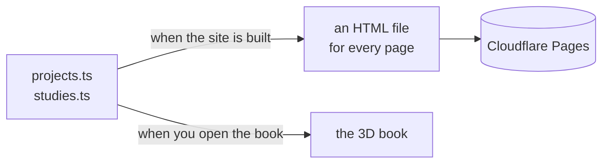
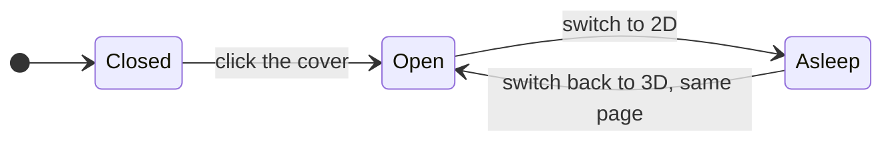

# kcb.pro

My portfolio, live at [kcb.pro](https://kcb.pro).

When you open it, you get a book. It's leather, it has brass corners and a green gem
on the cover, and it floats. Click it and the clasps come off and it opens. You can
flip through the pages, or pull one of the ribbons hanging out the bottom to skip to a
chapter.

If you'd rather not read a book (fair), hit 2D in the corner and you get a normal
website with the same stuff on it.

## What's in it

Three projects I'm working on:

- Deck Workshop keeps every version of your Hearthstone deck, so you can tell
  whether a change actually helped.
- Mugen Arena is a fighting game where each fighter is a text file. Edit a move, then
  go fight with it.
- Wander is a map that tells you what's around you, and what used to be there.

There are also three "work studies". In each one I spend a week figuring out how
something works (Figma's canvas, map labels) or how it should work (a state benefits
form).

Everything has a date on it. If something isn't done yet, it says so.

## How it works

All the words live in two TypeScript files. The build reads them and complains if
anything looks off: a missing date, a "TODO" left in, a link to nowhere. If they pass,
it writes out a plain HTML file for every page. That's the 2D site, and it works even
with JavaScript turned off.

The book reads the same two files, but it does it in your browser.

There are no 3D models or images in the book. The leather, the brass, the gem and
every page are drawn by code when it loads. Depending on who you ask, that's either
very cool or slightly unhinged.

Switching to 2D doesn't throw the book away. It zooms into the page you were on and
goes to sleep, so it isn't eating your battery in the background. Switch back and it
opens where you left it.

## Built with

React, TypeScript, Vite and Three.js, with plain hand-written CSS. Bun runs
everything locally, and the site is hosted on Cloudflare Pages. The fonts are Cinzel
and EB Garamond.

If you want the gory details, they're in [docs/](docs/).
