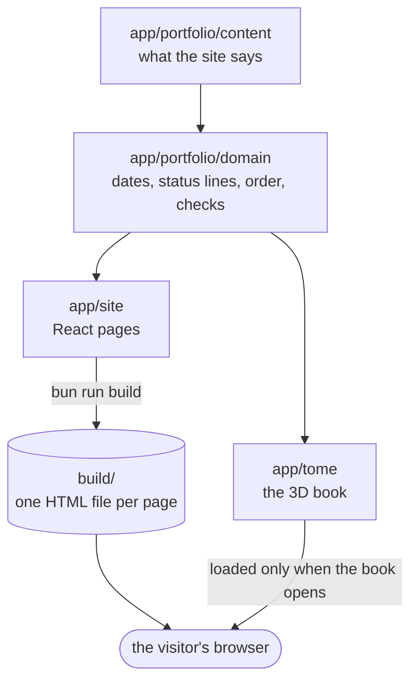

# How the site fits together

kcb.pro is a small React site that is built ahead of time into static HTML files and
served from Cloudflare Pages. There is no server and no database. Everything the site
says comes from two TypeScript files of content.

## Running it

You need [Bun](https://bun.sh) 1.3.11 or newer. Run `bun install` once, then:

| Command                    | What it does                                                         |
| -------------------------- | -------------------------------------------------------------------- |
| `bun run dev`              | Starts the dev server with hot reload.                               |
| `bun run build`            | Typechecks, builds, and prerenders every page into `build/`.         |
| `bun run preview`          | Serves `build/` the way Cloudflare Pages will, on port 4173.         |
| `bun run test`             | Unit and component tests (Vitest).                                   |
| `bun run test:integration` | Renders pages on the server, as the build does, and checks the HTML. |
| `bun run test:e2e`         | Builds the site and drives it in a real browser (Playwright).        |
| `bun run check`            | Everything CI runs: lint, build, and all three test suites.          |
| `bun run deploy`           | Uploads `build/` to Cloudflare Pages by hand. Normally CI does this. |

## The four parts of `app/`

### `app/portfolio/content`: what the site says

`projects.ts` and `studies.ts` hold every project and study as typed data, and
`index.ts` holds the profile (name, headline, GitHub link). To change what the site
says, change these files. See [content.md](content.md).

### `app/portfolio/domain`: the rules about that content

Small, pure functions with their own tests:

- `catalog.ts`: which project is "now building", the order of the work index, and
  the list of every page path.
- `status.ts`: the status line under each item, for example "In progress · as of
  22 Oct 2026" or "Planned · Jan 2027".
- `dates.ts`: date formatting. Dates are calendar days (`YYYY-MM-DD`), never times.
- `validate.ts`: the checks that fail the build on bad content.

Nothing in `domain/` knows about React, the browser or Three.js. If a rule is about
the portfolio rather than the page, it belongs here.

### `app/site`: the 2D site

- `AppRoutes.tsx`: the route table. The same tree renders on the server and in the
  browser, so prerendered pages hydrate without a mismatch.
- `pages/`: one component per page (home, work index, project, studies, about,
  404).
- `components/Layout.tsx`: the header, footer, the 3D/2D toggle, and the logic for
  when the book is shown.
- `meta.ts`: page titles and descriptions.

### `app/tome`: the 3D book

- `engine.js`: the Three.js scene. It builds the book, paints its pages and runs the
  animation.
- `copy.ts`: turns the content into the words on the book's pages.
- `place.ts`: maps book chapters to site pages and back, so switching views keeps
  the reader in the same place.

The engine is loaded only when it's needed, so the 2D pages never download Three.js.
See [the-tome.md](the-tome.md).

## From source to `build/`

`bun run build` does four things in order:

1. **Typecheck** the whole app (`tsc -b`).
2. **Build the browser bundle** with Vite into `build/`.
3. **Build a server bundle** of `app/entry-server.tsx` into `build-ssr/`.
4. **Prerender** (`scripts/prerender.ts`). This checks the content first and stops
   the build if anything is wrong. Then it renders every page path to its own HTML
   file, such as `build/work/wander.html`, plus `build/404.html`, and deletes
   `build-ssr/`.

Pages are written as `<path>.html` rather than `<path>/index.html` because Cloudflare
Pages redirects folder URLs to a trailing slash.

The build stamps every "as of" date with the day it ran (UTC). Set
`BUILD_DAY=YYYY-MM-DD` to pin it, which is useful for reproducing a past build.

## 3D or 2D: who decides

`Layout.tsx` decides whether the book is showing:

- **Home page:** the book opens by default. If a visitor picks 2D, that choice is
  remembered for the browser session.
- **Any other page:** the page shows first, always. The book only opens there if the
  visitor presses 3D on that page. It then opens at the chapter for that page.
- **No WebGL, or the engine fails to start:** the toggle is hidden and the site is
  2D only.

Once the book has been built, it stays in memory while hidden, so switching back is
instant.

## Tests

| Suite                      | Where                    | What it proves                                                          |
| -------------------------- | ------------------------ | ----------------------------------------------------------------------- |
| `bun run test`             | `app/**/*.test.ts(x)`    | Domain rules, content checks, pages, and the toggle with a fake engine. |
| `bun run test:integration` | `*.integration.test.tsx` | Server rendering produces the right HTML and status codes.              |
| `bun run test:e2e`         | `tests/e2e/`             | The prerendered build works in Chromium: navigation, toggle, layout.    |

The end-to-end tests swap the real 3D engine for a stub, because software WebGL in
headless browsers is too slow to render the book. Check changes to the book's look by
hand in a real browser. [the-tome.md](the-tome.md#debugging-the-3d-scene) explains how.

## Where does my change go?

| I want to…                           | Change…                                            |
| ------------------------------------ | -------------------------------------------------- |
| Add or edit a project or study       | `app/portfolio/content/` ([guide](content.md))     |
| Change how status or dates read      | `app/portfolio/domain/` (and its tests)            |
| Change a page's layout or add a page | `app/site/pages/`, `app/site/AppRoutes.tsx`        |
| Change colours, spacing or type      | `app/styles/tokens.css`                            |
| Change what the book says            | `app/tome/copy.ts`                                 |
| Change how the book looks or moves   | `app/tome/engine.js`                               |
| Change how deploys work              | `.github/workflows/ci.yml` ([guide](deploying.md)) |
