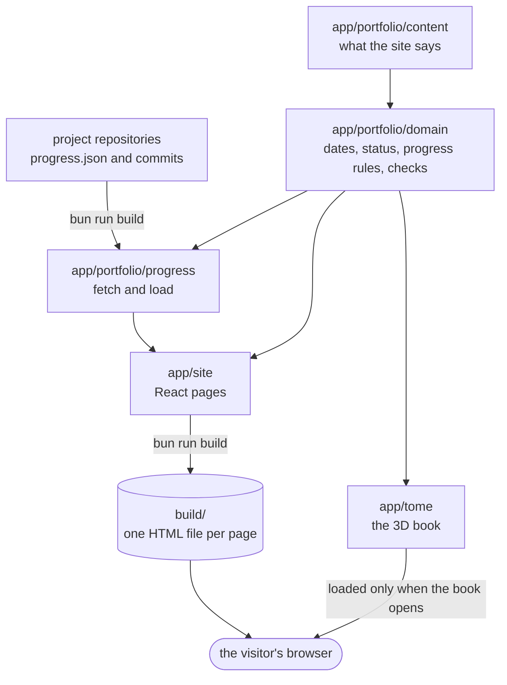

# Progress Ledger (Plan 1a) Implementation Plan

> **For agentic workers:** REQUIRED SUB-SKILL: Use superpowers:subagent-driven-development (recommended) or superpowers:executing-plans to implement this plan task-by-task. Steps use checkbox (`- [ ]`) syntax for tracking.

**Goal:** Every registered project page on kcb.pro shows a dated, evidence-first "Progress" ledger built at build time from `progress.json` in the project's own repository, and the home page features ranked work by rank.

**Architecture:** The `progress.json` contract, its rules and its derived views (`current`, counts, seal, quiet) are pure functions in `app/portfolio/domain/progress.ts`, with commit activity in `domain/activity.ts`. Ingestion (`app/portfolio/progress/fetch.ts`) is pure and injectable; `scripts/progress-fetch.ts` is the thin wrapper that the build runs first and that writes `build-data/progress/<slug>.json`. The client and SSR entries load those files with `import.meta.glob`, validate them, and pass them through `SiteProvider` the way `asOf` and `catalog` already flow; React components only render.

**Tech Stack:** React 19, React Router 7, Vite 6, TypeScript 5.7, Vitest 3 + Testing Library (jsdom), Playwright, Bun 1.3.11, GitHub REST API, GitHub Actions, Cloudflare Pages.

**Spec:** `docs/superpowers/specs/2026-10-22-progress-ledger-design.md` (everything labelled 1a). Plan 1b (generated book, `book` field, `layoutBook()`, wax seals) is written separately and builds on the contract below.

---

## Shared contract with plan 1b (do not rename)

- `app/portfolio/domain/progress.ts` exports types `ProgressResult = 'pass' | 'partial' | 'fail' | 'not-run'`, `ProgressKind = 'experiment' | 'tests' | 'release' | 'milestone'`, `Evidence = { label: string; path: string } | { label: string; url: string }`, `ProgressEntry`, `ProgressFile`, `CommitType`, `Commit = { sha: string; date: IsoDay; type: CommitType; subject: string; url: string }`, `ProjectProgress = { file: ProgressFile; commits: Commit[] }`, and functions `validateProgress(file: unknown, ctx: { slug: string; buildDay: IsoDay }): string[]`, `current(entries, day)` (latest per subject on or before day, newest first), `progressCounts(entries, day): { proven; partial; failed; open }`, `overallSeal(entries, day): ProgressResult | null`. It also exports `resultLabel(result)` (the result word), which 1b's seals can reuse.
- `useSite()` returns `progress: Record<string, ProjectProgress>`.
- `Project` gains `repo?: string` and `rank?: 1 | 2 | 3`. `featured(projects)` returns ranked listed endeavors ordered by rank. Content: Bezl `rank: 1`, kbui `rank: 2`, both with `repo`.
- Every ledger entry renders as an element whose `id` is the entry `id`, so `/work/<slug>#<entry-id>` lands on it (1b's seal links depend on this).

## Conventions (read once, apply everywhere)

- **Worktree:** all work happens in `/Users/khallil/proj/kcb.pro/.claude/worktrees/feat-progress-ledger-1a` (Task 1). Every path below is relative to it.
- **Style:** match the surrounding code: 2-space indent, single quotes, no semicolons, trailing commas `es5` (`.prettierrc`). Run `bunx prettier --write <file>` on files you **create**; do not reformat existing files wholesale.
- **Comments:** at most one line, only for intent, invariant, constraint or a non-obvious tradeoff. No narration.
- **TDD:** @superpowers:test-driven-development. Every behaviour change starts with a failing test you run and watch fail, then minimal code, then green. Exceptions are called out in the task with the reason and the verification used instead.
- **Single test file:** `npx vitest run --config vitest.config.ts <path>`. Vitest pins `__BUILD_DAY__` to `2026-10-21`.
- **Gate** (must pass before every commit; each commit must stand on its own):

  ```bash
  bun run lint && bun run typecheck && bun run build && bun run test && bun run test:integration && bun run test:e2e
  ```

  Expected: every command exits 0; Playwright ends with `passed` and no `failed`. Stop any server already listening on port 4173 first, or Playwright reuses it.

- **Commits:** Conventional Commit subjects, SSH-signed with `git commit -S`, no `Co-authored-by` and no AI attribution of any kind. After each commit, `git cat-file commit HEAD | grep -c 'BEGIN SSH SIGNATURE'` must print `1`.
- **Verification:** @superpowers:verification-before-completion. Report only checks actually run.

## File structure

| File                                                                                               | Responsibility                                                                                                                          |
| -------------------------------------------------------------------------------------------------- | --------------------------------------------------------------------------------------------------------------------------------------- |
| `app/portfolio/domain/dates.ts` (modify)                                                           | `isIsoDay`, `addDays`, `daysBetween`, `formatWeekday`                                                                                   |
| `app/portfolio/domain/progress.ts` (create)                                                        | Contract types, `validateProgress`, `validateCommits`, `current`, `progressCounts`, `overallSeal`, `quietSince`, labels, `evidenceHref` |
| `app/portfolio/domain/activity.ts` (create)                                                        | `classifyCommit`, `activityWeeks`, `commitGroups`                                                                                       |
| `app/portfolio/domain/types.ts` (modify)                                                           | `Project.repo`, `Project.rank`                                                                                                          |
| `app/portfolio/domain/validate.ts` (modify)                                                        | `repo` shape; `rank` once and only on listed endeavors                                                                                  |
| `app/portfolio/domain/catalog.ts` (modify)                                                         | `featured()` by rank; `registered()`                                                                                                    |
| `app/portfolio/domain/fixtures.ts` (modify)                                                        | Test builders `entry()`, `progressFile()`, `commit()`                                                                                   |
| `schema/progress.v1.json` (create)                                                                 | Published JSON Schema for the contract                                                                                                  |
| `app/portfolio/progress/load.ts` (create)                                                          | `loadProgress(files, buildDay)`: validate and key by slug                                                                               |
| `app/portfolio/progress/fetch.ts` (create)                                                         | `collectProgress(projects, options)`: GitHub or fixtures; throws on any failure                                                         |
| `app/portfolio/progress/fixtures/bezl.json`, `kbui.json` (create)                                  | Offline stand-ins (synthetic, dated on or before 2026-10-21)                                                                            |
| `app/portfolio/progress/fixture-progress.ts` (create)                                              | Fixtures loaded through `loadProgress`, for tests                                                                                       |
| `app/site/site.ts`, `app/site/site-context.tsx` (modify)                                           | `progress` in the site context                                                                                                          |
| `app/site/progress-data.ts` (create)                                                               | `import.meta.glob` over `build-data/progress`, validated on call                                                                        |
| `app/site/components/Ledger.tsx` (create)                                                          | The "Progress" section: counts, quiet, filters, entries, activity                                                                       |
| `app/site/components/LedgerEntry.tsx` (create)                                                     | One entry: date rail, result badge, pass mark, measured, evidence                                                                       |
| `app/site/components/Activity.tsx` (create)                                                        | Commit squares (a real table) and commits by type                                                                                       |
| `app/site/pages/ProjectPage.tsx`, `pages/Home.tsx` (modify)                                        | Ledger in place of BuildLog; "All work" after ranked cards                                                                              |
| `app/main.tsx`, `app/entry-server.tsx`, `scripts/prerender.ts` (modify)                            | Pass built progress into `SiteProvider`                                                                                                 |
| `scripts/build-day.ts` (create)                                                                    | The one build-day source for Vite and the fetch                                                                                         |
| `scripts/progress-fetch.ts` (create)                                                               | Thin wrapper: fetch or copy fixtures, write `build-data/`                                                                               |
| `vite.config.ts`, `package.json`, `playwright.config.ts`, `.gitignore`, `.prettierignore` (modify) | Wiring                                                                                                                                  |
| `.github/workflows/ci.yml` (modify)                                                                | Daily schedule, manual run, `GITHUB_TOKEN`, deploy condition                                                                            |
| `app/styles/site.css`, `app/styles/tokens.css` (modify)                                            | Ledger and activity styles; `--failing`, `--heat-*`, `--cell`                                                                           |
| `docs/content.md`, `docs/architecture.md`, `docs/deploying.md` (modify)                            | Docs                                                                                                                                    |

## Why the order matters

From Task 17 on, `bun run build` fetches every registered project's `progress.json` from GitHub and fails if it is missing. Bezl and kbui are registered (they get `repo`) in Task 8, but nothing fetches until Task 17, so Tasks 2–15 pass the gate offline. **Task 16 (the owner seeds `progress.json` in the Bezl and kbui repositories) must be done before Task 17**, or Task 17's gate and the PR's CI build fail by design.

---

### Task 1: Set up the worktree and confirm a green baseline

**Files:** none changed.

- [ ] **Step 1: Create the worktree from main**

```bash
cd /Users/khallil/proj/kcb.pro
git fetch origin
git worktree add .claude/worktrees/feat-progress-ledger-1a -b worktree/feat-progress-ledger-1a origin/main
cd .claude/worktrees/feat-progress-ledger-1a
git switch -c feat/progress-ledger
bun install --frozen-lockfile
```

Expected: `Preparing worktree (new branch 'worktree/feat-progress-ledger-1a')`, then `Switched to a new branch 'feat/progress-ledger'`, then bun installs with no lockfile changes. `worktree/feat-progress-ledger-1a` is a scratch session branch and is never pushed; `feat/progress-ledger` is the PR branch.

The spec and this plan are not on `main` yet: they live in `/Users/khallil/proj/kcb.pro/.claude/worktrees/spec-progress-ledger` (spec commit `809015b` on the local branch `worktree/spec-progress-ledger`; the plan is uncommitted there). Read them from that absolute path. Do not copy them into this branch; they land through their own docs PR.

- [ ] **Step 2: Prove signing and GitHub access before any commit**

```bash
git config user.name; git config user.email
git config commit.gpgsign; git config gpg.format; git config user.signingkey
gh api repos/KhallilB/kcb.pro --jq .full_name
```

Expected: your name and email; `true`; `ssh`; a key path or key; `KhallilB/kcb.pro`. If any is missing, fix the identity or signing configuration and rerun. If it cannot be fixed, stop and ask the owner. Do not commit until all pass.

- [ ] **Step 3: Confirm the baseline gate is green**

Run the Gate. Expected: all pass. If anything fails on untouched `main`, stop and report it; do not build on a red baseline.

---

### Task 2: Day arithmetic for the ledger

**Files:**

- Modify: `app/portfolio/domain/dates.ts`
- Test: `app/portfolio/domain/dates.test.ts`

- [ ] **Step 1: Write the failing tests**

Replace the import line of `app/portfolio/domain/dates.test.ts` and add four tests inside the existing `describe('dates', …)`:

```ts
import {
  addDays,
  daysBetween,
  formatDay,
  formatMonth,
  formatWeekday,
  isIsoDay,
} from './dates'
```

```ts
it('tells a real ISO day from anything else', () => {
  expect(isIsoDay('2026-10-21')).toBe(true)
  expect(isIsoDay('2026-02-30')).toBe(false)
  expect(isIsoDay('21 Oct 2026')).toBe(false)
})

it('steps whole days across month and year ends', () => {
  expect(addDays('2026-10-21', -83)).toBe('2026-07-30')
  expect(addDays('2026-12-31', 1)).toBe('2027-01-01')
})

it('counts the days from one day to a later one', () => {
  expect(daysBetween('2026-09-20', '2026-10-21')).toBe(31)
  expect(daysBetween('2026-10-21', '2026-10-21')).toBe(0)
})

it('names the weekday of a day', () => {
  expect(formatWeekday('2026-10-21')).toBe('Wednesday')
})
```

- [ ] **Step 2: Run them to see them fail**

Run: `npx vitest run --config vitest.config.ts app/portfolio/domain/dates.test.ts`
Expected: FAIL, 4 failed, with `isIsoDay is not a function` (and the same for the others).

- [ ] **Step 3: Implement**

Append to `app/portfolio/domain/dates.ts`:

```ts
export function isIsoDay(day: string): boolean {
  try {
    parse(day)
    return true
  } catch {
    return false
  }
}

const DAY_MS = 86_400_000

function utc(day: IsoDay): number {
  const { year, month, date } = parse(day)
  return Date.UTC(year, month - 1, date)
}

export function addDays(day: IsoDay, days: number): IsoDay {
  return new Date(utc(day) + days * DAY_MS).toISOString().slice(0, 10)
}

export function daysBetween(from: IsoDay, to: IsoDay): number {
  return Math.round((utc(to) - utc(from)) / DAY_MS)
}

const WEEKDAYS = [
  'Sunday',
  'Monday',
  'Tuesday',
  'Wednesday',
  'Thursday',
  'Friday',
  'Saturday',
]

export function formatWeekday(day: IsoDay): string {
  return WEEKDAYS[new Date(utc(day)).getUTCDay()]
}
```

- [ ] **Step 4: Run the tests to see them pass**

Run: `npx vitest run --config vitest.config.ts app/portfolio/domain/dates.test.ts`
Expected: PASS, `7 passed`.

- [ ] **Step 5: Gate and commit**

Run the Gate, then:

```bash
git add app/portfolio/domain/dates.ts app/portfolio/domain/dates.test.ts
git commit -S -m "feat(domain): day arithmetic for the progress ledger"
git cat-file commit HEAD | grep -c 'BEGIN SSH SIGNATURE'
```

Expected: last command prints `1`.

---

### Task 3: The progress.json contract and its validation

**Files:**

- Create: `app/portfolio/domain/progress.ts`
- Modify: `app/portfolio/domain/fixtures.ts`
- Test: `app/portfolio/domain/progress.test.ts`

- [ ] **Step 1: Add test builders**

Append to `app/portfolio/domain/fixtures.ts` (and extend its import):

```ts
import type { Commit, ProgressEntry, ProgressFile } from './progress'
```

```ts
export function entry(overrides: Partial<ProgressEntry> = {}): ProgressEntry {
  return {
    id: '2026-10-20-alpha',
    subject: 'alpha',
    date: '2026-10-20',
    kind: 'experiment',
    title: 'Alpha holds up',
    passMark: 'Under 100 ms',
    result: 'pass',
    measured: [{ label: 'Median', value: '40 ms' }],
    evidence: [{ label: 'RESULT.md', path: 'spikes/alpha/RESULT.md' }],
    commit: '01e47db',
    ...overrides,
  }
}

export function progressFile(
  entries: ProgressEntry[],
  overrides: Partial<ProgressFile> = {}
): ProgressFile {
  return { schema: 1, project: 'alpha', entries, ...overrides }
}

export function commit(overrides: Partial<Commit> = {}): Commit {
  return {
    sha: '01e47db',
    date: '2026-10-20',
    type: 'feat',
    subject: 'feat: add alpha',
    url: 'https://github.com/KhallilB/alpha/commit/01e47db',
    ...overrides,
  }
}
```

- [ ] **Step 2: Write the failing tests**

Create `app/portfolio/domain/progress.test.ts`:

```ts
import {
  validateCommits,
  validateProgress,
  type Evidence,
  type Measure,
  type ProgressEntry,
  type ProgressKind,
  type ProgressResult,
} from './progress'
import { commit, entry, progressFile } from './fixtures'

const ctx = { slug: 'alpha', buildDay: '2026-10-21' }
const check = (entries: ProgressEntry[]) =>
  validateProgress(progressFile(entries), ctx)
const at = '"alpha" progress.json entry "2026-10-20-alpha"'

describe('validateProgress', () => {
  it('accepts a complete file', () => {
    expect(check([entry()])).toEqual([])
  })

  it('accepts evidence as an https url with no commit', () => {
    const run = {
      label: 'CI run',
      url: 'https://github.com/o/r/actions/runs/1',
    }
    expect(check([entry({ evidence: [run], commit: undefined })])).toEqual([])
  })

  it('refuses anything that is not an object', () => {
    expect(validateProgress([], ctx)).toEqual([
      '"alpha" progress.json is not a JSON object',
    ])
  })

  it.each([0, 2, '1'])('refuses schema %j', (schema) => {
    expect(validateProgress({ ...progressFile([]), schema }, ctx)).toEqual([
      `"alpha" progress.json uses schema ${JSON.stringify(schema)}; kcb.pro reads schema 1`,
    ])
  })

  it('refuses a file written for another project', () => {
    expect(
      validateProgress(progressFile([], { project: 'beta' }), ctx)
    ).toEqual([
      '"alpha" progress.json names project "beta"; it must be "alpha"',
    ])
  })

  it('refuses a file with no entries list', () => {
    expect(validateProgress({ schema: 1, project: 'alpha' }, ctx)).toEqual([
      '"alpha" progress.json needs an entries list',
    ])
  })

  it('refuses two entries with one id', () => {
    expect(check([entry(), entry()])).toContain(`${at} repeats an earlier id`)
  })

  it('refuses an id that cannot be an anchor', () => {
    expect(check([entry({ id: 'two words' })])).toContain(
      '"alpha" progress.json entry "two words" needs an id with no spaces'
    )
    expect(check([entry({ id: '' })])).toContain(
      '"alpha" progress.json entry 1 needs an id with no spaces'
    )
  })

  it('refuses a date after the build day', () => {
    expect(check([entry({ date: '2026-10-22' })])).toContain(
      `${at} is dated 2026-10-22, after the build day 2026-10-21`
    )
  })

  it('refuses a date that is not an ISO day', () => {
    expect(check([entry({ date: '2026-13-01' })])).toContain(
      `${at} needs a date as YYYY-MM-DD`
    )
  })

  it('refuses entries out of date order', () => {
    const errors = check([
      entry({ id: 'b', date: '2026-10-20' }),
      entry({ id: 'a', subject: 'other', date: '2026-10-19' }),
    ])
    expect(errors).toContain(
      '"alpha" progress.json entry "a" is out of order; entries go oldest first'
    )
  })

  it('refuses an unknown kind or result', () => {
    expect(check([entry({ kind: 'demo' as ProgressKind })])).toContain(
      `${at} has an unknown kind "demo"`
    )
    expect(check([entry({ result: 'flaky' as ProgressResult })])).toContain(
      `${at} has an unknown result "flaky"`
    )
  })

  it.each(['experiment', 'tests'] as ProgressKind[])(
    'requires a pass mark for %s',
    (kind) => {
      expect(check([entry({ kind, passMark: undefined })])).toContain(
        `${at} needs a passMark, set before the result`
      )
    }
  )

  it.each(['release', 'milestone'] as ProgressKind[])(
    'lets %s go without a pass mark',
    (kind) => {
      expect(check([entry({ kind, passMark: undefined })])).toEqual([])
    }
  )

  it('requires evidence unless the result is not-run', () => {
    expect(check([entry({ evidence: [], commit: undefined })])).toContain(
      `${at} needs evidence unless its result is not-run`
    )
    expect(
      check([entry({ result: 'not-run', evidence: [], commit: undefined })])
    ).toEqual([])
  })

  it('requires a commit when evidence is a repository path', () => {
    expect(check([entry({ commit: undefined })])).toContain(
      `${at} links a repository path, so it needs a commit`
    )
  })

  it('refuses a commit that is not a hash', () => {
    expect(check([entry({ commit: 'main' })])).toContain(
      `${at} has a commit that is not a hash: main`
    )
  })

  it.each([
    [
      { label: 'Run', url: 'http://example.com' },
      'evidence "Run" needs an https url',
    ],
    [
      { label: 'Doc', path: '/etc/passwd' },
      'evidence "Doc" needs a path inside the repository',
    ],
    [
      { label: 'Doc', path: 'a/../../b' },
      'evidence "Doc" needs a path inside the repository',
    ],
    [
      { label: 'Both', path: 'a', url: 'https://x.y' },
      'evidence "Both" needs exactly one of path or url',
    ],
    [{ path: 'a' }, 'evidence needs a label'],
  ])('refuses evidence %j', (item, problem) => {
    expect(check([entry({ evidence: [item as Evidence] })])).toContain(
      `${at} ${problem}`
    )
  })

  it('refuses measured values that are not label and value', () => {
    expect(
      check([entry({ measured: [{ label: 'Median' }] as Measure[] })])
    ).toContain(`${at} needs measured as a list of { label, value }`)
  })
})

describe('validateCommits', () => {
  it('accepts well-formed commits', () => {
    expect(validateCommits([commit()], 'alpha')).toEqual([])
  })

  it('refuses anything but a list', () => {
    expect(validateCommits({}, 'alpha')).toEqual([
      '"alpha" commits are not a list',
    ])
  })

  it('refuses a malformed commit, by position', () => {
    expect(validateCommits([commit({ date: 'yesterday' })], 'alpha')).toEqual([
      '"alpha" commit 1 is not a { sha, date, type, subject, url } record',
    ])
  })
})
```

- [ ] **Step 3: Run them to see them fail**

Run: `npx vitest run --config vitest.config.ts app/portfolio/domain/progress.test.ts`
Expected: FAIL with `Failed to resolve import "./progress"`.

- [ ] **Step 4: Implement the contract**

Create `app/portfolio/domain/progress.ts`:

```ts
import { isIsoDay } from './dates'
import type { IsoDay } from './types'

// Contract version written against; the version before it is still read.
export const PROGRESS_SCHEMA = 1
const READABLE = [PROGRESS_SCHEMA - 1, PROGRESS_SCHEMA].filter((v) => v >= 1)

export const PROGRESS_RESULTS = ['pass', 'partial', 'fail', 'not-run'] as const
export type ProgressResult = (typeof PROGRESS_RESULTS)[number]

export const PROGRESS_KINDS = [
  'experiment',
  'tests',
  'release',
  'milestone',
] as const
export type ProgressKind = (typeof PROGRESS_KINDS)[number]

export const COMMIT_TYPES = [
  'feat',
  'fix',
  'docs',
  'test',
  'refactor',
  'chore',
  'other',
] as const
export type CommitType = (typeof COMMIT_TYPES)[number]

export type Evidence =
  | { label: string; path: string }
  | { label: string; url: string }

export interface Measure {
  label: string
  value: string
}

export interface ProgressEntry {
  // Unique in the file; the entry's HTML anchor.
  id: string
  // Entries about the same thing over time share a subject.
  subject: string
  date: IsoDay
  kind: ProgressKind
  title: string
  // What counted as success, decided before the result.
  passMark?: string
  result: ProgressResult
  measured: Measure[]
  evidence: Evidence[]
  commit?: string
}

export interface ProgressFile {
  schema: number
  project: string
  // Append-only, oldest first.
  entries: ProgressEntry[]
}

export type Commit = {
  sha: string
  date: IsoDay
  type: CommitType
  subject: string
  url: string
}

export type ProjectProgress = { file: ProgressFile; commits: Commit[] }

const NEEDS_PASS_MARK: readonly string[] = ['experiment', 'tests']
const HASH = /^[0-9a-f]{7,40}$/

type Fields = Record<string, unknown>

const isRecord = (v: unknown): v is Fields =>
  typeof v === 'object' && v !== null && !Array.isArray(v)

const isText = (v: unknown): v is string =>
  typeof v === 'string' && v.trim() !== ''

const isOneOf = <T extends string>(list: readonly T[], v: unknown): v is T =>
  list.includes(v as T)

export function validateProgress(
  file: unknown,
  ctx: { slug: string; buildDay: IsoDay }
): string[] {
  const at = `"${ctx.slug}" progress.json`
  if (!isRecord(file)) return [`${at} is not a JSON object`]
  const errors: string[] = []
  if (!READABLE.includes(file.schema as number)) {
    errors.push(
      `${at} uses schema ${JSON.stringify(file.schema)}; kcb.pro reads schema ${READABLE.join(' or ')}`
    )
  }
  if (file.project !== ctx.slug) {
    errors.push(
      `${at} names project ${JSON.stringify(file.project)}; it must be "${ctx.slug}"`
    )
  }
  if (!Array.isArray(file.entries))
    return [...errors, `${at} needs an entries list`]

  const ids = new Set<string>()
  let latest = ''
  file.entries.forEach((entry: unknown, index) => {
    if (!isRecord(entry)) {
      errors.push(`${at} entry ${index + 1} is not an object`)
      return
    }
    const where = `${at} entry ${isText(entry.id) ? `"${entry.id}"` : index + 1}`
    errors.push(...entryErrors(entry, where, ctx.buildDay))
    if (isText(entry.id)) {
      if (ids.has(entry.id)) errors.push(`${where} repeats an earlier id`)
      ids.add(entry.id)
    }
    if (typeof entry.date === 'string' && isIsoDay(entry.date)) {
      if (entry.date < latest) {
        errors.push(`${where} is out of order; entries go oldest first`)
      } else {
        latest = entry.date
      }
    }
  })
  return errors
}

function entryErrors(e: Fields, where: string, buildDay: IsoDay): string[] {
  const errors: string[] = []
  if (!isText(e.id) || /\s/.test(e.id)) {
    errors.push(`${where} needs an id with no spaces`)
  }
  if (!isText(e.subject)) errors.push(`${where} needs a subject`)
  if (typeof e.date !== 'string' || !isIsoDay(e.date)) {
    errors.push(`${where} needs a date as YYYY-MM-DD`)
  } else if (e.date > buildDay) {
    errors.push(`${where} is dated ${e.date}, after the build day ${buildDay}`)
  }
  if (!isOneOf(PROGRESS_KINDS, e.kind)) {
    errors.push(`${where} has an unknown kind ${JSON.stringify(e.kind)}`)
  }
  if (!isText(e.title)) errors.push(`${where} needs a title`)
  const needsMark = NEEDS_PASS_MARK.includes(e.kind as string)
  if ((needsMark || e.passMark !== undefined) && !isText(e.passMark)) {
    errors.push(`${where} needs a passMark, set before the result`)
  }
  if (!isOneOf(PROGRESS_RESULTS, e.result)) {
    errors.push(`${where} has an unknown result ${JSON.stringify(e.result)}`)
  }
  const measured =
    Array.isArray(e.measured) &&
    e.measured.every((m) => isRecord(m) && isText(m.label) && isText(m.value))
  if (!measured) {
    errors.push(`${where} needs measured as a list of { label, value }`)
  }
  if (!Array.isArray(e.evidence)) {
    errors.push(`${where} needs an evidence list`)
  } else {
    for (const item of e.evidence) {
      const problem = evidenceProblem(item)
      if (problem) errors.push(`${where} evidence ${problem}`)
    }
    if (e.evidence.length === 0 && e.result !== 'not-run') {
      errors.push(`${where} needs evidence unless its result is not-run`)
    }
    const linksPath = e.evidence.some(
      (item) => isRecord(item) && 'path' in item
    )
    if (linksPath && !isText(e.commit)) {
      errors.push(`${where} links a repository path, so it needs a commit`)
    }
  }
  if (
    e.commit !== undefined &&
    !(typeof e.commit === 'string' && HASH.test(e.commit))
  ) {
    errors.push(`${where} has a commit that is not a hash: ${String(e.commit)}`)
  }
  return errors
}

function evidenceProblem(item: unknown): string | null {
  if (!isRecord(item) || !isText(item.label)) return 'needs a label'
  const name = `"${item.label}"`
  if ('path' in item === 'url' in item) {
    return `${name} needs exactly one of path or url`
  }
  if ('url' in item) {
    const https =
      typeof item.url === 'string' && /^https:\/\/\S+$/.test(item.url)
    return https ? null : `${name} needs an https url`
  }
  const path = item.path
  const inside =
    isText(path) && !path.startsWith('/') && !path.split('/').includes('..')
  return inside ? null : `${name} needs a path inside the repository`
}

const isCommit = (c: unknown) =>
  isRecord(c) &&
  typeof c.sha === 'string' &&
  HASH.test(c.sha) &&
  typeof c.date === 'string' &&
  isIsoDay(c.date) &&
  isOneOf(COMMIT_TYPES, c.type) &&
  typeof c.subject === 'string' &&
  typeof c.url === 'string' &&
  c.url.startsWith('https://')

export function validateCommits(commits: unknown, slug: string): string[] {
  if (!Array.isArray(commits)) return [`"${slug}" commits are not a list`]
  return commits.flatMap((c: unknown, i) =>
    isCommit(c)
      ? []
      : [
          `"${slug}" commit ${i + 1} is not a { sha, date, type, subject, url } record`,
        ]
  )
}
```

- [ ] **Step 5: Run the tests to see them pass**

Run: `npx vitest run --config vitest.config.ts app/portfolio/domain/progress.test.ts`
Expected: PASS, `30 passed` (counting the `it.each` rows).

- [ ] **Step 6: Gate and commit**

```bash
bunx prettier --write app/portfolio/domain/progress.ts app/portfolio/domain/progress.test.ts
```

Run the Gate, then:

```bash
git add app/portfolio/domain/progress.ts app/portfolio/domain/progress.test.ts app/portfolio/domain/fixtures.ts
git commit -S -m "feat(domain): progress.json contract and its validation"
git cat-file commit HEAD | grep -c 'BEGIN SSH SIGNATURE'
```

---

### Task 4: Derived views: current, counts, seal, quiet, labels, evidence links

**Files:**

- Modify: `app/portfolio/domain/progress.ts`
- Test: `app/portfolio/domain/progress.test.ts`

- [ ] **Step 1: Write the failing tests**

Extend the import at the top of `progress.test.ts` with `current`, `evidenceHref`, `kindLabel`, `overallSeal`, `PROGRESS_KINDS`, `PROGRESS_RESULTS`, `progressCounts`, `quietSince`, `resultLabel`, then append:

```ts
const day = '2026-10-21'

describe('current', () => {
  const first = entry({
    id: 'a1',
    subject: 'a',
    date: '2026-10-01',
    result: 'fail',
  })
  const other = entry({ id: 'b1', subject: 'b', date: '2026-10-05' })
  const rerun = entry({ id: 'a2', subject: 'a', date: '2026-10-10' })

  it('keeps the latest entry per subject, newest first', () => {
    expect(current([first, other, rerun], day).map((e) => e.id)).toEqual([
      'a2',
      'b1',
    ])
  })

  it('reads the record as it stood on an earlier day', () => {
    expect(
      current([first, other, rerun], '2026-10-06').map((e) => e.id)
    ).toEqual(['b1', 'a1'])
  })

  it('lets a later entry on the same day replace an earlier one', () => {
    const morning = entry({ id: 'm', subject: 's', result: 'fail' })
    const evening = entry({ id: 'e', subject: 's', result: 'pass' })
    expect(current([morning, evening], day).map((e) => e.id)).toEqual(['e'])
  })

  it('orders same-day subjects with the last written first', () => {
    const x = entry({ id: 'x', subject: 'x' })
    const y = entry({ id: 'y', subject: 'y' })
    expect(current([x, y], day).map((e) => e.id)).toEqual(['y', 'x'])
  })
})

describe('progressCounts', () => {
  it('counts current subjects as proven, partial, failed and open', () => {
    const entries = [
      entry({ id: '1', subject: 'a', date: '2026-10-01', result: 'fail' }),
      entry({ id: '2', subject: 'a', date: '2026-10-02', result: 'pass' }),
      entry({ id: '3', subject: 'b', result: 'partial' }),
      entry({ id: '4', subject: 'c', result: 'fail' }),
      entry({ id: '5', subject: 'd', result: 'not-run' }),
    ]
    expect(progressCounts(entries, day)).toEqual({
      proven: 1,
      partial: 1,
      failed: 1,
      open: 1,
    })
  })
})

describe('overallSeal', () => {
  it.each([
    [[], null],
    [['pass', 'pass'], 'pass'],
    [['pass', 'partial'], 'partial'],
    [['pass', 'not-run'], 'partial'],
    [['partial', 'fail'], 'fail'],
  ] as [ProgressResult[], ProgressResult | null][])(
    'seals %j as %s',
    (results, seal) => {
      const entries = results.map((result, i) =>
        entry({ id: `e${i}`, subject: `s${i}`, result })
      )
      expect(overallSeal(entries, day)).toBe(seal)
    }
  )
})

describe('quietSince', () => {
  it('names the newest entry once it is more than 30 days old', () => {
    const entries = [
      entry({ id: 'a', date: '2026-09-01' }),
      entry({ id: 'b', date: '2026-09-20' }),
    ]
    expect(quietSince(entries, day)).toBe('2026-09-20')
  })

  it('stays silent within 30 days, or with no entries', () => {
    expect(quietSince([entry({ date: '2026-09-21' })], day)).toBeNull()
    expect(quietSince([], day)).toBeNull()
  })
})

describe('words and links', () => {
  it('words every result and kind', () => {
    expect(PROGRESS_RESULTS.map((r) => resultLabel(r))).toEqual([
      'Pass',
      'Partial',
      'Fail',
      'Not run',
    ])
    expect(PROGRESS_KINDS.map((k) => kindLabel(k))).toEqual([
      'Experiment',
      'Tests',
      'Release',
      'Milestone',
    ])
  })

  it('links a repository path at its commit, and a url as given', () => {
    expect(
      evidenceHref(
        { label: 'R', path: 'spikes/a/RESULT.md' },
        'KhallilB/bezl',
        '01e47db'
      )
    ).toBe('https://github.com/KhallilB/bezl/blob/01e47db/spikes/a/RESULT.md')
    expect(
      evidenceHref(
        { label: 'Run', url: 'https://github.com/o/r/actions/runs/1' },
        'KhallilB/bezl'
      )
    ).toBe('https://github.com/o/r/actions/runs/1')
  })
})
```

- [ ] **Step 2: Run them to see them fail**

Run: `npx vitest run --config vitest.config.ts app/portfolio/domain/progress.test.ts`
Expected: FAIL; the new tests error with `current is not a function` (and the others likewise); Task 3's tests still pass.

- [ ] **Step 3: Implement**

In `progress.ts`, change the dates import to `import { daysBetween, isIsoDay } from './dates'` and append:

```ts
// Latest entry per subject on or before day, newest first; a later same-day entry wins.
export function current(
  entries: ProgressEntry[],
  day: IsoDay
): ProgressEntry[] {
  const latest = new Map<string, number>()
  entries.forEach((entry, index) => {
    if (entry.date > day) return
    const seen = latest.get(entry.subject)
    if (seen === undefined || entry.date >= entries[seen].date) {
      latest.set(entry.subject, index)
    }
  })
  return [...latest.values()]
    .sort((a, b) => entries[b].date.localeCompare(entries[a].date) || b - a)
    .map((index) => entries[index])
}

export interface ProgressCounts {
  proven: number
  partial: number
  failed: number
  open: number
}

const COUNTED_AS: Record<ProgressResult, keyof ProgressCounts> = {
  pass: 'proven',
  partial: 'partial',
  fail: 'failed',
  'not-run': 'open',
}

export function progressCounts(
  entries: ProgressEntry[],
  day: IsoDay
): ProgressCounts {
  const counts = { proven: 0, partial: 0, failed: 0, open: 0 }
  for (const entry of current(entries, day)) counts[COUNTED_AS[entry.result]]++
  return counts
}

// Any failure fails the project; anything short of all passing is partial.
export function overallSeal(
  entries: ProgressEntry[],
  day: IsoDay
): ProgressResult | null {
  const results = current(entries, day).map((e) => e.result)
  if (results.length === 0) return null
  if (results.includes('fail')) return 'fail'
  return results.every((r) => r === 'pass') ? 'pass' : 'partial'
}

const QUIET_AFTER_DAYS = 30

export function quietSince(
  entries: ProgressEntry[],
  day: IsoDay
): IsoDay | null {
  const newest = entries
    .map((e) => e.date)
    .filter((d) => d <= day)
    .sort()
    .at(-1)
  return newest !== undefined && daysBetween(newest, day) > QUIET_AFTER_DAYS
    ? newest
    : null
}

const RESULT_LABELS: Record<ProgressResult, string> = {
  pass: 'Pass',
  partial: 'Partial',
  fail: 'Fail',
  'not-run': 'Not run',
}

export const resultLabel = (result: ProgressResult) => RESULT_LABELS[result]

const KIND_LABELS: Record<ProgressKind, string> = {
  experiment: 'Experiment',
  tests: 'Tests',
  release: 'Release',
  milestone: 'Milestone',
}

export const kindLabel = (kind: ProgressKind) => KIND_LABELS[kind]

// A path is linked at the commit that recorded it, so the link never drifts.
export function evidenceHref(
  item: Evidence,
  repo: string,
  commit?: string
): string {
  return 'url' in item
    ? item.url
    : `https://github.com/${repo}/blob/${commit}/${item.path}`
}
```

- [ ] **Step 4: Run the tests to see them pass**

Run: `npx vitest run --config vitest.config.ts app/portfolio/domain/progress.test.ts`
Expected: PASS, all green.

- [ ] **Step 5: Gate and commit**

Run the Gate, then:

```bash
git add app/portfolio/domain/progress.ts app/portfolio/domain/progress.test.ts
git commit -S -m "feat(domain): current view, counts, seal and quiet for progress"
git cat-file commit HEAD | grep -c 'BEGIN SSH SIGNATURE'
```

---

### Task 5: Publish `schema/progress.v1.json`, held to the domain

**Files:**

- Create: `schema/progress.v1.json`
- Test: `app/portfolio/progress/schema.test.ts`

- [ ] **Step 1: Write the failing test**

Create `app/portfolio/progress/schema.test.ts`:

```ts
import schema from '../../../schema/progress.v1.json'
import { entry, progressFile } from '../domain/fixtures'
import {
  PROGRESS_KINDS,
  PROGRESS_RESULTS,
  PROGRESS_SCHEMA,
  validateProgress,
  type ProgressEntry,
} from '../domain/progress'

const ctx = { slug: 'alpha', buildDay: '2026-10-21' }

describe('schema/progress.v1.json', () => {
  it('describes the contract version the domain writes against', () => {
    expect(schema.properties.schema.const).toBe(PROGRESS_SCHEMA)
  })

  it('lists the same kinds and results as the domain', () => {
    expect(schema.$defs.entry.properties.kind.enum).toEqual([...PROGRESS_KINDS])
    expect(schema.$defs.entry.properties.result.enum).toEqual([
      ...PROGRESS_RESULTS,
    ])
  })

  it.each(schema.$defs.entry.required)(
    'requires %s, and so does the domain',
    (field) => {
      const bare: Record<string, unknown> = { ...entry() }
      delete bare[field]
      expect(
        validateProgress(progressFile([bare as unknown as ProgressEntry]), ctx)
      ).not.toEqual([])
    }
  )
})
```

- [ ] **Step 2: Run it to see it fail**

Run: `npx vitest run --config vitest.config.ts app/portfolio/progress/schema.test.ts`
Expected: FAIL with `Failed to resolve import "../../../schema/progress.v1.json"`.

- [ ] **Step 3: Write the schema**

Create `schema/progress.v1.json`:

```json
{
  "$schema": "https://json-schema.org/draft/2020-12/schema",
  "$id": "https://raw.githubusercontent.com/KhallilB/kcb.pro/main/schema/progress.v1.json",
  "title": "kcb.pro progress file, version 1",
  "description": "progress.json at a project's repository root. Entries are append-only and sorted by date, oldest first. kcb.pro also checks that ids are unique, that no date is after the build day, and that project equals the kcb.pro slug.",
  "type": "object",
  "required": ["schema", "project", "entries"],
  "properties": {
    "schema": { "const": 1 },
    "project": { "$ref": "#/$defs/text" },
    "entries": { "type": "array", "items": { "$ref": "#/$defs/entry" } }
  },
  "$defs": {
    "text": { "type": "string", "pattern": "\\S" },
    "entry": {
      "type": "object",
      "required": [
        "id",
        "subject",
        "date",
        "kind",
        "title",
        "result",
        "measured",
        "evidence"
      ],
      "properties": {
        "id": { "type": "string", "pattern": "^\\S+$" },
        "subject": { "$ref": "#/$defs/text" },
        "date": { "type": "string", "pattern": "^\\d{4}-\\d{2}-\\d{2}$" },
        "kind": { "enum": ["experiment", "tests", "release", "milestone"] },
        "title": { "$ref": "#/$defs/text" },
        "passMark": { "$ref": "#/$defs/text" },
        "result": { "enum": ["pass", "partial", "fail", "not-run"] },
        "measured": {
          "type": "array",
          "items": {
            "type": "object",
            "required": ["label", "value"],
            "properties": {
              "label": { "$ref": "#/$defs/text" },
              "value": { "$ref": "#/$defs/text" }
            }
          }
        },
        "evidence": {
          "type": "array",
          "items": { "$ref": "#/$defs/evidence" }
        },
        "commit": { "type": "string", "pattern": "^[0-9a-f]{7,40}$" }
      },
      "allOf": [
        {
          "if": {
            "properties": { "kind": { "enum": ["experiment", "tests"] } }
          },
          "then": { "required": ["passMark"] }
        },
        {
          "if": {
            "properties": { "result": { "not": { "const": "not-run" } } }
          },
          "then": { "properties": { "evidence": { "minItems": 1 } } }
        },
        {
          "if": {
            "properties": {
              "evidence": { "contains": { "required": ["path"] } }
            }
          },
          "then": { "required": ["commit"] }
        }
      ]
    },
    "evidence": {
      "oneOf": [
        {
          "type": "object",
          "required": ["label", "path"],
          "not": { "required": ["url"] },
          "properties": {
            "label": { "$ref": "#/$defs/text" },
            "path": {
              "type": "string",
              "pattern": "^(?!/)(?!(.*/)?\\.\\.(/|$)).+$"
            }
          }
        },
        {
          "type": "object",
          "required": ["label", "url"],
          "not": { "required": ["path"] },
          "properties": {
            "label": { "$ref": "#/$defs/text" },
            "url": { "type": "string", "pattern": "^https://\\S+$" }
          }
        }
      ]
    }
  }
}
```

- [ ] **Step 4: Run the test to see it pass**

Run: `npx vitest run --config vitest.config.ts app/portfolio/progress/schema.test.ts`
Expected: PASS, 10 tests (2 + 8 required fields).

- [ ] **Step 5: Gate and commit**

Run the Gate, then:

```bash
git add schema/progress.v1.json app/portfolio/progress/schema.test.ts
git commit -S -m "feat: publish schema/progress.v1.json"
git cat-file commit HEAD | grep -c 'BEGIN SSH SIGNATURE'
```

---

### Task 6: Commit activity: classification, weekly grid, groups

**Files:**

- Create: `app/portfolio/domain/activity.ts`
- Test: `app/portfolio/domain/activity.test.ts`

- [ ] **Step 1: Write the failing tests**

Create `app/portfolio/domain/activity.test.ts`:

```ts
import { activityWeeks, classifyCommit, commitGroups } from './activity'
import { commit } from './fixtures'

describe('classifyCommit', () => {
  it.each([
    ['feat(ui): add the Control Room', 'feat'],
    ['fix: stop the flicker', 'fix'],
    ['docs(spec): progress ledger', 'docs'],
    ['test(react): enforce story and test', 'test'],
    ['refactor!: rename Facet', 'refactor'],
    ['chore(main): release 0.1.0', 'chore'],
    ['build(deps): install kbui', 'other'],
    ['Merge pull request #3 from KhallilB/x', 'other'],
    ['content: link Bezl', 'other'],
  ])('reads "%s" as %s', (subject, type) => {
    expect(classifyCommit(subject)).toBe(type)
  })
})

describe('activityWeeks', () => {
  it('lays out twelve weeks of days ending on the build day', () => {
    const weeks = activityWeeks([], '2026-10-21')
    expect(weeks).toHaveLength(12)
    expect(weeks.every((week) => week.length === 7)).toBe(true)
    expect(weeks[0][0].day).toBe('2026-07-30')
    expect(weeks[11][6].day).toBe('2026-10-21')
  })

  it('counts commits per day and ignores days outside the window', () => {
    const weeks = activityWeeks(
      [
        commit({ date: '2026-10-21' }),
        commit({ sha: 'bbbbbbb', date: '2026-10-21' }),
        commit({ sha: 'ccccccc', date: '2026-07-29' }),
      ],
      '2026-10-21'
    )
    expect(weeks[11][6].count).toBe(2)
    expect(weeks.flat().reduce((sum, d) => sum + d.count, 0)).toBe(2)
  })
})

describe('commitGroups', () => {
  it('groups by type in a fixed order, newest first, skipping empty types', () => {
    const older = commit({ sha: 'aaaaaaa', date: '2026-10-01' })
    const newer = commit({ sha: 'bbbbbbb', date: '2026-10-09' })
    const fix = commit({ sha: 'ccccccc', type: 'fix' })
    const other = commit({ sha: 'ddddddd', type: 'other' })
    expect(
      commitGroups([other, older, fix, newer]).map((g) => [
        g.type,
        g.commits.map((c) => c.sha),
      ])
    ).toEqual([
      ['feat', ['bbbbbbb', 'aaaaaaa']],
      ['fix', ['ccccccc']],
      ['other', ['ddddddd']],
    ])
  })
})
```

- [ ] **Step 2: Run them to see them fail**

Run: `npx vitest run --config vitest.config.ts app/portfolio/domain/activity.test.ts`
Expected: FAIL with `Failed to resolve import "./activity"`.

- [ ] **Step 3: Implement**

Create `app/portfolio/domain/activity.ts`:

```ts
import { addDays } from './dates'
import { COMMIT_TYPES, type Commit, type CommitType } from './progress'
import type { IsoDay } from './types'

const PREFIX = /^(\w+)(?:\([^)]*\))?!?:/

export function classifyCommit(subject: string): CommitType {
  const type = PREFIX.exec(subject)?.[1]
  return COMMIT_TYPES.includes(type as CommitType)
    ? (type as CommitType)
    : 'other'
}

export interface DayCount {
  day: IsoDay
  count: number
}

// Columns of seven days, oldest first; the last day is the build day.
export function activityWeeks(
  commits: Commit[],
  day: IsoDay,
  weeks = 12
): DayCount[][] {
  const counts = new Map<IsoDay, number>()
  for (const c of commits) counts.set(c.date, (counts.get(c.date) ?? 0) + 1)
  const start = addDays(day, 1 - weeks * 7)
  return Array.from({ length: weeks }, (_, week) =>
    Array.from({ length: 7 }, (_, offset) => {
      const at = addDays(start, week * 7 + offset)
      return { day: at, count: counts.get(at) ?? 0 }
    })
  )
}

export interface CommitGroup {
  type: CommitType
  commits: Commit[]
}

export function commitGroups(commits: Commit[]): CommitGroup[] {
  const newest = [...commits].sort((a, b) => b.date.localeCompare(a.date))
  return COMMIT_TYPES.map((type) => ({
    type,
    commits: newest.filter((c) => c.type === type),
  })).filter((group) => group.commits.length > 0)
}
```

- [ ] **Step 4: Run the tests to see them pass**

Run: `npx vitest run --config vitest.config.ts app/portfolio/domain/activity.test.ts`
Expected: PASS, 12 tests.

- [ ] **Step 5: Gate and commit**

```bash
bunx prettier --write app/portfolio/domain/activity.ts app/portfolio/domain/activity.test.ts
```

Run the Gate, then:

```bash
git add app/portfolio/domain/activity.ts app/portfolio/domain/activity.test.ts
git commit -S -m "feat(domain): classify commits and lay out twelve weeks of activity"
git cat-file commit HEAD | grep -c 'BEGIN SSH SIGNATURE'
```

---

### Task 7: `repo` and `rank` on a project, validated

**Files:**

- Modify: `app/portfolio/domain/types.ts:25-42`
- Modify: `app/portfolio/domain/validate.ts`
- Test: `app/portfolio/domain/validate.test.ts`

Fixed-place collisions for ranked slugs (`contents`, `about`, `more-work`, …) are a book rule and land in plan 1b with `layoutBook()`.

- [ ] **Step 1: Add the fields**

In `app/portfolio/domain/types.ts`, inside `interface Project` after `listed?: boolean`:

```ts
  // Public GitHub repository as owner/name; registers the project's progress ledger.
  repo?: string
  // Place in Selected work; set by hand, never derived.
  rank?: 1 | 2 | 3
```

(No behaviour yet; this lets the tests compile.)

- [ ] **Step 2: Write the failing tests**

Append inside `describe('validateCatalog', …)` in `validate.test.ts`:

```ts
it('accepts a repo named owner/name', () => {
  expect(
    validateCatalog(catalog([project({ repo: 'KhallilB/bezl' })]))
  ).toEqual([])
})

it('refuses a repo that is not owner/name', () => {
  const errors = validateCatalog(
    catalog([project({ repo: 'https://github.com/KhallilB/bezl' })])
  )
  expect(errors).toContain(
    '"alpha" has a repo that is not owner/name: https://github.com/KhallilB/bezl'
  )
})

it('accepts one project per rank', () => {
  const errors = validateCatalog(
    catalog([project({ rank: 1 }), project({ slug: 'beta', rank: 2 })])
  )
  expect(errors).toEqual([])
})

it('refuses two projects with one rank', () => {
  const errors = validateCatalog(
    catalog([project({ rank: 1 }), project({ slug: 'beta', rank: 1 })])
  )
  expect(errors).toContain('Rank 1 is used by "alpha" and "beta"')
})

it.each([
  ['the site', { kind: 'site' as const }],
  ['a hidden project', { listed: false }],
])('refuses a rank on %s', (_, overrides) => {
  const errors = validateCatalog(catalog([project({ rank: 1, ...overrides })]))
  expect(errors).toContain('"alpha" has a rank but is not a listed endeavor')
})
```

- [ ] **Step 3: Run them to see them fail**

Run: `npx vitest run --config vitest.config.ts app/portfolio/domain/validate.test.ts`
Expected: FAIL; 4 failures (`refuses a repo…`, `refuses two projects…`, both `refuses a rank…`), the acceptance tests pass.

- [ ] **Step 4: Implement**

In `validate.ts`, add after the `PLACEHOLDER` helpers:

```ts
const REPO = /^[A-Za-z0-9-]+\/[A-Za-z0-9._-]+$/
```

Inside `for (const p of catalog.projects) { … }`, after the links loop:

```ts
if (p.repo !== undefined && !REPO.test(p.repo)) {
  errors.push(`"${p.slug}" has a repo that is not owner/name: ${p.repo}`)
}
if (p.rank !== undefined && (p.kind !== 'endeavor' || p.listed === false)) {
  errors.push(`"${p.slug}" has a rank but is not a listed endeavor`)
}
```

After that loop closes, before `const projectSlugs = …`:

```ts
const byRank = new Map<number, string[]>()
for (const p of catalog.projects) {
  if (p.rank !== undefined)
    byRank.set(p.rank, [...(byRank.get(p.rank) ?? []), p.slug])
}
for (const [rank, slugs] of byRank) {
  if (slugs.length > 1) {
    errors.push(
      `Rank ${rank} is used by ${slugs.map((s) => `"${s}"`).join(' and ')}`
    )
  }
}
```

- [ ] **Step 5: Run the tests to see them pass**

Run: `npx vitest run --config vitest.config.ts app/portfolio/domain/validate.test.ts`
Expected: PASS, all green.

- [ ] **Step 6: Gate and commit**

Run the Gate, then:

```bash
git add app/portfolio/domain/types.ts app/portfolio/domain/validate.ts app/portfolio/domain/validate.test.ts
git commit -S -m "feat(domain): repo and rank on a project, validated"
git cat-file commit HEAD | grep -c 'BEGIN SSH SIGNATURE'
```

---

### Task 8: Ranked "Selected work", `registered()`, and Bezl and kbui registered

**Files:**

- Modify: `app/portfolio/domain/catalog.ts:18-20`
- Modify: `app/portfolio/content/projects.ts` (bezl and kbui entries)
- Modify: `app/site/pages/Home.tsx:33-58`
- Modify: `app/styles/site.css` (after `.section__head`)
- Test: `app/portfolio/domain/catalog.test.ts`, `app/portfolio/content/content.test.ts`, `app/site/pages.test.tsx`

- [ ] **Step 1: Write the failing tests**

In `catalog.test.ts`, add `registered` to the import and replace the test `'features endeavors only, in season order'` with:

```ts
it('features ranked endeavors by rank, never by season order', () => {
  const first = project({ slug: 'first', order: 3, rank: 1 })
  const second = project({ slug: 'second', order: 1, rank: 2 })
  const unranked = project({ slug: 'unranked', order: 0 })
  expect(featured([second, unranked, site, first]).map((p) => p.slug)).toEqual([
    'first',
    'second',
  ])
})

it('registers listed projects that name a repo', () => {
  const tracked = project({ slug: 'tracked', repo: 'KhallilB/tracked' })
  const hidden = project({
    slug: 'hidden',
    repo: 'KhallilB/hidden',
    listed: false,
  })
  expect(registered([tracked, hidden, next])).toEqual([
    { slug: 'tracked', repo: 'KhallilB/tracked' },
  ])
})
```

In `content.test.ts`, change the import to `import { featured, nowBuilding, registered } from '../domain/catalog'`, rename `'features exactly Bezl and kbui, in season order'` to `'features exactly Bezl and kbui, by rank'` (body unchanged), and add:

```ts
it('registers Bezl and kbui by their public repositories', () => {
  expect(registered(content.projects)).toEqual([
    { slug: 'bezl', repo: 'KhallilB/bezl' },
    { slug: 'kbui', repo: 'KhallilB/kbui' },
  ])
})
```

In `pages.test.tsx`, replace `'features the two endeavors with dated status'` with:

```tsx
it('features ranked work by rank, then links to all of it', () => {
  visit('/')
  const work = screen.getByRole('region', { name: 'Selected work' })
  const cards = within(work).getAllByRole('article')
  expect(cards.map((c) => within(c).getByRole('heading').textContent)).toEqual([
    'Bezl',
    'kbui',
  ])
  expect(cards[0]).toHaveTextContent('In progress · as of 21 Oct 2026')
  expect(cards[1]).toHaveTextContent('In progress · as of 21 Oct 2026')
  const last = within(work).getAllByRole('link').at(-1)
  expect(last).toHaveAccessibleName('All work')
  expect(last).toHaveAttribute('href', '/work')
})
```

- [ ] **Step 2: Run them to see them fail**

Run: `npx vitest run --config vitest.config.ts app/portfolio/domain/catalog.test.ts app/portfolio/content/content.test.ts app/site/pages.test.tsx`
Expected: FAIL: `features ranked endeavors by rank…` (got all endeavors by order), `registered is not a function` (twice), and `features ranked work…` (last link is the kbui card, not "All work").

- [ ] **Step 3: Redefine `featured()` and add `registered()`**

In `catalog.ts`, replace `featured` with:

```ts
export function featured(projects: Project[]): Project[] {
  return projects
    .filter(
      (p) => p.kind === 'endeavor' && p.listed !== false && p.rank !== undefined
    )
    .sort((a, b) => (a.rank ?? 0) - (b.rank ?? 0))
}

// Listed projects with a repo; each must publish a valid progress.json.
export function registered(
  projects: Project[]
): { slug: string; repo: string }[] {
  return projects.flatMap((p) =>
    p.repo && p.listed !== false ? [{ slug: p.slug, repo: p.repo }] : []
  )
}
```

Run: `npx vitest run --config vitest.config.ts app/portfolio/domain/catalog.test.ts app/portfolio/content/content.test.ts`
Expected: catalog tests PASS; content tests now FAIL `features exactly Bezl and kbui, by rank` (got `[]`) and `registers Bezl and kbui…` (got `[]`). That is the content gap the next step closes.

- [ ] **Step 4: Rank and register Bezl and kbui**

In `app/portfolio/content/projects.ts`, in the `bezl` entry after `order: 1,` add:

```ts
    rank: 1,
    repo: 'KhallilB/bezl',
```

In the `kbui` entry after `order: 2,` add:

```ts
    rank: 2,
    repo: 'KhallilB/kbui',
```

- [ ] **Step 5: Move "All work" after the ranked cards**

In `app/site/pages/Home.tsx`, replace the Selected work section with:

```tsx
<section className="section" aria-labelledby="selected-work">
  <div className="section__head">
    <h2 id="selected-work" className="h3">
      Selected work
    </h2>
  </div>
  <div className="cards">
    {work.map((project) => (
      <article key={project.slug} className="card" data-place={project.slug}>
        <div className="card__body">
          <h3 className="card__title">
            <Link to={`/work/${project.slug}`} className="card__link">
              {project.title}
            </Link>
          </h3>
          <p className="secondary">{project.summary}</p>
          <p className="card__about">{project.about}</p>
          <StatusChip item={project} />
        </div>
      </article>
    ))}
  </div>
  <p className="section__more">
    <Link to="/work" className="link">
      All work <span aria-hidden="true">→</span>
    </Link>
  </p>
</section>
```

In `app/styles/site.css`, after the `.section__head { … }` block:

```css
.section__more {
  margin-block-start: var(--space-4);
}
```

- [ ] **Step 6: Run the tests to see them pass**

Run: `npx vitest run --config vitest.config.ts app/portfolio/domain/catalog.test.ts app/portfolio/content/content.test.ts app/site/pages.test.tsx`
Expected: PASS, all green.

- [ ] **Step 7: Gate and commit**

Run the Gate (the build does not fetch yet, so `repo` changes nothing there), then:

```bash
git add app/portfolio/domain/catalog.ts app/portfolio/domain/catalog.test.ts app/portfolio/content/projects.ts app/portfolio/content/content.test.ts app/site/pages/Home.tsx app/site/pages.test.tsx app/styles/site.css
git commit -S -m "feat: rank Selected work and register Bezl and kbui"
git cat-file commit HEAD | grep -c 'BEGIN SSH SIGNATURE'
```

---

### Task 9: Offline fixtures and the build-data loader

**Files:**

- Create: `app/portfolio/progress/load.ts`
- Create: `app/portfolio/progress/fixtures/bezl.json`, `app/portfolio/progress/fixtures/kbui.json`
- Create: `app/portfolio/progress/fixture-progress.ts`
- Test: `app/portfolio/progress/load.test.ts`, `app/portfolio/progress/fixture-progress.test.ts`

Fixtures are synthetic. They reuse real Bezl spike evidence and real commit hashes, with dates moved to on or before the pinned test day 2026-10-21 (the real Bezl entries are dated 2026-10-22). Each file has the `ProjectProgress` shape, `{ file, commits }`, because offline mode copies it straight to `build-data/progress/<slug>.json`.

- [ ] **Step 1: Write the failing tests**

Create `app/portfolio/progress/load.test.ts`:

```ts
import { commit, entry, progressFile } from '../domain/fixtures'
import { loadProgress } from './load'

const day = '2026-10-21'
const data = (slug: string) => ({
  file: progressFile([entry()], { project: slug }),
  commits: [commit()],
})

describe('loadProgress', () => {
  it('reads no files as no progress', () => {
    expect(loadProgress({}, day)).toEqual({})
  })

  it('keys each file by its slug', () => {
    expect(
      loadProgress({ '/build-data/progress/alpha.json': data('alpha') }, day)
    ).toEqual({ alpha: data('alpha') })
  })

  it('refuses a file that breaks the contract, naming the file', () => {
    const late = {
      ...data('alpha'),
      file: progressFile([entry({ date: '2026-10-22' })]),
    }
    expect(() =>
      loadProgress({ '/build-data/progress/alpha.json': late }, day)
    ).toThrow(/build-data\/progress\/alpha\.json[\s\S]*after the build day/)
  })

  it('refuses malformed commits', () => {
    expect(() =>
      loadProgress(
        { '/x/alpha.json': { ...data('alpha'), commits: [{}] } },
        day
      )
    ).toThrow('"alpha" commit 1')
  })
})
```

Create `app/portfolio/progress/fixture-progress.test.ts`:

```ts
import { content } from '../content'
import { registered } from '../domain/catalog'
import { progressCounts } from '../domain/progress'
import { fixtureProgress } from './fixture-progress'

describe('offline fixtures', () => {
  it('cover every registered project', () => {
    expect(Object.keys(fixtureProgress).sort()).toEqual(
      registered(content.projects)
        .map((p) => p.slug)
        .sort()
    )
  })

  it('give Bezl every kind of result but failed', () => {
    expect(
      progressCounts(fixtureProgress.bezl.file.entries, '2026-10-21')
    ).toEqual({
      proven: 3,
      partial: 1,
      failed: 0,
      open: 2,
    })
  })
})
```

- [ ] **Step 2: Run them to see them fail**

Run: `npx vitest run --config vitest.config.ts app/portfolio/progress/load.test.ts app/portfolio/progress/fixture-progress.test.ts`
Expected: FAIL with `Failed to resolve import "./load"` and `Failed to resolve import "./fixture-progress"`.

- [ ] **Step 3: Implement the loader**

Create `app/portfolio/progress/load.ts`:

```ts
import {
  validateCommits,
  validateProgress,
  type ProjectProgress,
} from '../domain/progress'
import type { IsoDay } from '../domain/types'

// Keys are file paths; the file name is the project slug.
export function loadProgress(
  files: Record<string, unknown>,
  buildDay: IsoDay
): Record<string, ProjectProgress> {
  const loaded: Record<string, ProjectProgress> = {}
  for (const [path, data] of Object.entries(files)) {
    const slug = path.slice(path.lastIndexOf('/') + 1).replace(/\.json$/, '')
    const { file, commits } = (data ?? {}) as {
      file?: unknown
      commits?: unknown
    }
    const errors = [
      ...validateProgress(file, { slug, buildDay }),
      ...validateCommits(commits, slug),
    ]
    if (errors.length > 0) {
      throw new Error(`${path} failed validation:\n${errors.join('\n')}`)
    }
    loaded[slug] = { file, commits } as ProjectProgress
  }
  return loaded
}
```

- [ ] **Step 4: Write the fixtures**

Create `app/portfolio/progress/fixtures/bezl.json`:

```json
{
  "file": {
    "schema": 1,
    "project": "bezl",
    "entries": [
      {
        "id": "2026-10-20-pty-throughput",
        "subject": "pty-throughput",
        "date": "2026-10-20",
        "kind": "experiment",
        "title": "Terminal output into the window",
        "passMark": "No lost bytes, echo under 100 ms, memory under 300 MB",
        "result": "partial",
        "measured": [
          { "label": "Bytes lost", "value": "None across 3 × 20 MB" },
          { "label": "Echo latency, median", "value": "2 ms" },
          { "label": "Peak memory", "value": "492 MB" }
        ],
        "evidence": [
          { "label": "RESULT.md", "path": "spikes/01-pty-throughput/RESULT.md" }
        ],
        "commit": "01e47db"
      },
      {
        "id": "2026-10-20-libghostty-vt",
        "subject": "libghostty-vt",
        "date": "2026-10-20",
        "kind": "experiment",
        "title": "Terminal snapshots from Ghostty’s engine",
        "passMark": "Clean build under 5 minutes, and a plain-text vim snapshot that matches",
        "result": "pass",
        "measured": [
          { "label": "Clean build", "value": "42 s" },
          { "label": "Vim snapshot", "value": "Matches" }
        ],
        "evidence": [
          { "label": "RESULT.md", "path": "spikes/02-libghostty-vt/RESULT.md" }
        ],
        "commit": "01e47db"
      },
      {
        "id": "2026-10-20-reviewer-readonly-codex",
        "subject": "reviewer-readonly-codex",
        "date": "2026-10-20",
        "kind": "experiment",
        "title": "A Codex reviewer cannot write",
        "passMark": "The write is refused and the refusal shows in the output",
        "result": "pass",
        "measured": [
          { "label": "target.txt after the probe", "value": "Unchanged" }
        ],
        "evidence": [
          {
            "label": "RESULT.md",
            "path": "spikes/03-reviewer-readonly/RESULT.md"
          }
        ],
        "commit": "01e47db"
      },
      {
        "id": "2026-10-20-reviewer-readonly-claude",
        "subject": "reviewer-readonly-claude",
        "date": "2026-10-20",
        "kind": "experiment",
        "title": "A Claude Code reviewer cannot write",
        "passMark": "The write is refused and the refusal shows in the output",
        "result": "not-run",
        "measured": [],
        "evidence": []
      },
      {
        "id": "2026-10-21-pty-memory",
        "subject": "pty-memory",
        "date": "2026-10-21",
        "kind": "experiment",
        "title": "Terminal memory trip-wires",
        "passMark": "Idle under 150 MB, burst peak under 600 MB at the 1 MiB high-water mark",
        "result": "not-run",
        "measured": [],
        "evidence": [
          { "label": "Decision", "path": "spikes/01-pty-throughput/RESULT.md" }
        ],
        "commit": "2230356"
      },
      {
        "id": "2026-10-21-scaffold",
        "subject": "scaffold",
        "date": "2026-10-21",
        "kind": "milestone",
        "title": "Desktop app scaffolded",
        "result": "pass",
        "measured": [],
        "evidence": [
          {
            "label": "Commit",
            "url": "https://github.com/KhallilB/bezl/commit/01e47db2f079b759ac01a43e4aad0b9f9fe35467"
          }
        ]
      }
    ]
  },
  "commits": [
    {
      "sha": "95ca237",
      "date": "2026-10-21",
      "type": "refactor",
      "subject": "refactor(ui): call the look the app theme",
      "url": "https://github.com/KhallilB/bezl/commit/95ca237f9978afe6771d3e806ae3c9b400f294b3"
    },
    {
      "sha": "c8f48d9",
      "date": "2026-10-21",
      "type": "refactor",
      "subject": "refactor(ui): follow kbui's rename of Facet to Panel",
      "url": "https://github.com/KhallilB/bezl/commit/c8f48d9aa077e97a5aab6a4cd0e3390e7c6dbc2d"
    },
    {
      "sha": "6384f48",
      "date": "2026-10-21",
      "type": "feat",
      "subject": "feat(ui): light the Control Room through kbui's rounded glass Facet",
      "url": "https://github.com/KhallilB/bezl/commit/6384f48df34636ee0b79d8ae229b2553e3dcb65a"
    },
    {
      "sha": "1ff2bd9",
      "date": "2026-10-21",
      "type": "fix",
      "subject": "fix(ui): drop cut-corner tokens from the skin",
      "url": "https://github.com/KhallilB/bezl/commit/1ff2bd924c9252ee7a2a831e7588fbecd5109c39"
    },
    {
      "sha": "621516a",
      "date": "2026-10-21",
      "type": "feat",
      "subject": "feat(ui): rebuild the Control Room as the Lit Room with an orbit map",
      "url": "https://github.com/KhallilB/bezl/commit/621516a33562c2955925495452d582c0f19e2f84"
    },
    {
      "sha": "64dc136",
      "date": "2026-10-21",
      "type": "feat",
      "subject": "feat(ui): give the Control Room one faceted design language",
      "url": "https://github.com/KhallilB/bezl/commit/64dc1366f58d6ca207810dc8d01c9537e1fa2601"
    },
    {
      "sha": "0ba5e6f",
      "date": "2026-10-21",
      "type": "other",
      "subject": "build(deps): install kbui 0.1.0 from GitHub release tarballs",
      "url": "https://github.com/KhallilB/bezl/commit/0ba5e6fa2a8d0fdee55de4d53c355aa999186a6f"
    },
    {
      "sha": "5bc5aa6",
      "date": "2026-10-21",
      "type": "feat",
      "subject": "feat(ui): add the Faceted Operations skin and the Control Room screen",
      "url": "https://github.com/KhallilB/bezl/commit/5bc5aa613443016f1157ada51a8b5d438a8c17e1"
    },
    {
      "sha": "d2dafb0",
      "date": "2026-10-21",
      "type": "chore",
      "subject": "chore: add MIT license",
      "url": "https://github.com/KhallilB/bezl/commit/d2dafb083db8950cdfb8f0c581e9e88c049343e3"
    },
    {
      "sha": "2230356",
      "date": "2026-10-21",
      "type": "docs",
      "subject": "docs: accept Tauri with memory trip-wires for PTY panes",
      "url": "https://github.com/KhallilB/bezl/commit/2230356d307b1716ae27bfeace399b1035f1011a"
    },
    {
      "sha": "01e47db",
      "date": "2026-10-21",
      "type": "feat",
      "subject": "feat: scaffold Bezl and record the three stack spikes",
      "url": "https://github.com/KhallilB/bezl/commit/01e47db2f079b759ac01a43e4aad0b9f9fe35467"
    }
  ]
}
```

Create `app/portfolio/progress/fixtures/kbui.json`:

```json
{
  "file": {
    "schema": 1,
    "project": "kbui",
    "entries": [
      {
        "id": "2026-10-16-first-components",
        "subject": "first-components",
        "date": "2026-10-16",
        "kind": "milestone",
        "title": "Button, Input and Dialog",
        "result": "pass",
        "measured": [],
        "evidence": [
          { "label": "Components", "path": "packages/react/src/components" }
        ],
        "commit": "2a5fd82"
      },
      {
        "id": "2026-10-16-component-checks",
        "subject": "component-checks",
        "date": "2026-10-16",
        "kind": "tests",
        "title": "Component tests and story accessibility scan",
        "passMark": "Every component has a test and a story, and every story renders in a browser with no accessibility violations",
        "result": "pass",
        "measured": [
          { "label": "Component tests", "value": "28 passed" },
          { "label": "Stories scanned", "value": "16 passed" }
        ],
        "evidence": [{ "label": "Story tests", "path": "apps/storybook" }],
        "commit": "25b26eb"
      },
      {
        "id": "2026-10-21-release-0-1-0",
        "subject": "release",
        "date": "2026-10-21",
        "kind": "release",
        "title": "Release 0.1.0",
        "result": "pass",
        "measured": [],
        "evidence": [
          {
            "label": "Release notes",
            "url": "https://github.com/KhallilB/kbui/releases/tag/v0.1.0"
          }
        ]
      }
    ]
  },
  "commits": [
    {
      "sha": "2a5fd82",
      "date": "2026-10-16",
      "type": "fix",
      "subject": "fix: make path installs work; drop cross-package deps, document bun add by path",
      "url": "https://github.com/KhallilB/kbui/commit/2a5fd824d794081155a8ef9b2c4534883a303230"
    },
    {
      "sha": "e366e77",
      "date": "2026-10-16",
      "type": "chore",
      "subject": "chore: ignore .infigraph, drop backups ignore",
      "url": "https://github.com/KhallilB/kbui/commit/e366e772e4bb9e20b5b2e3d2eb994542f67a1e13"
    },
    {
      "sha": "dc4c17f",
      "date": "2026-10-16",
      "type": "docs",
      "subject": "docs: describe local consumption instead of a registry",
      "url": "https://github.com/KhallilB/kbui/commit/dc4c17fabce18ed94a6eff3122bbd2dbed9af6c9"
    },
    {
      "sha": "529f69c",
      "date": "2026-10-16",
      "type": "fix",
      "subject": "fix(generator): validate before writing, safe paths, exact-output tests",
      "url": "https://github.com/KhallilB/kbui/commit/529f69c158a1a3f5b031831375d8d6574d562eb4"
    },
    {
      "sha": "c7b2240",
      "date": "2026-10-16",
      "type": "chore",
      "subject": "chore: add ci workflow, readme and license",
      "url": "https://github.com/KhallilB/kbui/commit/c7b22408c38b2cb41d528881fef98cd171db2050"
    },
    {
      "sha": "4f67e37",
      "date": "2026-10-16",
      "type": "feat",
      "subject": "feat: component generator and templates",
      "url": "https://github.com/KhallilB/kbui/commit/4f67e37179c38308984c267332dceba8ce7d888c"
    },
    {
      "sha": "25b26eb",
      "date": "2026-10-16",
      "type": "feat",
      "subject": "feat(storybook): add docs app with a11y and story tests",
      "url": "https://github.com/KhallilB/kbui/commit/25b26eb09f0cf5233cddca5d406de01ea354c2c3"
    },
    {
      "sha": "70b52f7",
      "date": "2026-10-16",
      "type": "test",
      "subject": "test(react): enforce story and test per component",
      "url": "https://github.com/KhallilB/kbui/commit/70b52f76db5154bfe84086da07328aadd13a1fb1"
    },
    {
      "sha": "2384527",
      "date": "2026-10-16",
      "type": "feat",
      "subject": "feat(react): add Dialog",
      "url": "https://github.com/KhallilB/kbui/commit/23845270a497eff09c75254141e8741d4a34b81e"
    },
    {
      "sha": "ee05cd5",
      "date": "2026-10-16",
      "type": "feat",
      "subject": "feat(react): add Input",
      "url": "https://github.com/KhallilB/kbui/commit/ee05cd5304035e961a57894fe7804cc49ad194e7"
    },
    {
      "sha": "3dc1ac3",
      "date": "2026-10-16",
      "type": "feat",
      "subject": "feat(react): add Button",
      "url": "https://github.com/KhallilB/kbui/commit/3dc1ac35ce4aa3a478b3ea1915d653060433cc13"
    },
    {
      "sha": "0ad9bac",
      "date": "2026-10-16",
      "type": "feat",
      "subject": "feat(tokens): add DTCG token source and css/ts build",
      "url": "https://github.com/KhallilB/kbui/commit/0ad9bac5c19a7c1a39ec38839d998b30b45396b0"
    }
  ]
}
```

- [ ] **Step 5: Load the fixtures for tests**

Create `app/portfolio/progress/fixture-progress.ts`:

```ts
import { loadProgress } from './load'

// Test and offline data, checked as the build checks fetched data.
export const fixtureProgress = loadProgress(
  import.meta.glob('./fixtures/*.json', { eager: true, import: 'default' }),
  '2026-10-21'
)
```

- [ ] **Step 6: Run the tests to see them pass**

Run: `npx vitest run --config vitest.config.ts app/portfolio/progress/load.test.ts app/portfolio/progress/fixture-progress.test.ts`
Expected: PASS, 6 tests.

- [ ] **Step 7: Gate and commit**

```bash
bunx prettier --write app/portfolio/progress/load.ts app/portfolio/progress/load.test.ts app/portfolio/progress/fixture-progress.ts app/portfolio/progress/fixture-progress.test.ts
```

Run the Gate, then:

```bash
git add app/portfolio/progress
git commit -S -m "feat(progress): offline fixtures and the build-data loader"
git cat-file commit HEAD | grep -c 'BEGIN SSH SIGNATURE'
```

---

### Task 10: Ingestion: `collectProgress` from GitHub or fixtures

**Files:**

- Create: `app/portfolio/progress/fetch.ts`
- Test: `app/portfolio/progress/fetch.test.ts`

`fetch.ts` takes `fetch` and `readFixture` as arguments and uses only relative imports, so Bun can run it from `scripts/` and Vitest can drive it with a fake GitHub. It never touches the file system.

- [ ] **Step 1: Write the failing tests**

Create `app/portfolio/progress/fetch.test.ts`:

```ts
import { commit, entry, progressFile } from '../domain/fixtures'
import { collectProgress, type CollectOptions } from './fetch'

const bezl = { slug: 'bezl', repo: 'KhallilB/bezl' }
const kbui = { slug: 'kbui', repo: 'KhallilB/kbui' }
const goodFile = () => progressFile([entry()], { project: 'bezl' })

type Route = (url: URL) => Response
const json = (body: unknown) => new Response(JSON.stringify(body))
const missing = () => new Response('Not Found', { status: 404 })

function apiCommit(sha: string, date: string, message: string) {
  return {
    sha,
    html_url: `https://github.com/KhallilB/bezl/commit/${sha}`,
    commit: { message, author: { date: `${date}T12:00:00Z` } },
  }
}

function publicRepo(file: unknown = goodFile(), commits: unknown[] = []) {
  const routes: Record<string, Route> = {
    '/repos/KhallilB/bezl': () =>
      json({ private: false, default_branch: 'trunk' }),
    '/repos/KhallilB/bezl/contents/progress.json': () => json(file),
    '/repos/KhallilB/bezl/commits': () => json(commits),
  }
  return routes
}

function github(routes: Record<string, Route>) {
  const calls: { url: URL; headers: Record<string, string> }[] = []
  const fetch = async (input: string | URL | Request, init?: RequestInit) => {
    const url = new URL(String(input))
    calls.push({
      url,
      headers: (init?.headers ?? {}) as Record<string, string>,
    })
    return (routes[url.pathname] ?? missing)(url)
  }
  return { fetch: fetch as typeof globalThis.fetch, calls }
}

function options(overrides: Partial<CollectOptions> = {}): CollectOptions {
  return {
    buildDay: '2026-10-21',
    offline: false,
    fetch: () => Promise.reject(new Error('no network in this test')),
    readFixture: async () => undefined,
    ...overrides,
  }
}

describe('collectProgress from GitHub', () => {
  it('reads progress.json from the default branch with 90 days of classified commits', async () => {
    const full = '01e47db2f079b759ac01a43e4aad0b9f9fe35467'
    const { fetch, calls } = github(
      publicRepo(goodFile(), [
        apiCommit(full, '2026-10-20', 'feat: scaffold Bezl\n\nBody.'),
      ])
    )
    const progress = await collectProgress([bezl], options({ fetch }))
    expect(progress.bezl.file).toEqual(goodFile())
    expect(progress.bezl.commits).toEqual([
      {
        sha: '01e47db',
        date: '2026-10-20',
        type: 'feat',
        subject: 'feat: scaffold Bezl',
        url: `https://github.com/KhallilB/bezl/commit/${full}`,
      },
    ])
    const file = calls.find((c) => c.url.pathname.endsWith('/progress.json'))
    expect(file?.url.searchParams.get('ref')).toBe('trunk')
    const history = calls.find((c) => c.url.pathname.endsWith('/commits'))
    expect(Object.fromEntries(history?.url.searchParams ?? [])).toMatchObject({
      sha: 'trunk',
      since: '2026-07-24T00:00:00Z',
      until: '2026-10-21T23:59:59Z',
      per_page: '100',
      page: '1',
    })
  })

  it('authenticates with GITHUB_TOKEN when it has one', async () => {
    const withToken = github(publicRepo())
    await collectProgress(
      [bezl],
      options({ fetch: withToken.fetch, token: 't0k' })
    )
    expect(
      withToken.calls.every((c) => c.headers.authorization === 'Bearer t0k')
    ).toBe(true)
    const anonymous = github(publicRepo())
    await collectProgress([bezl], options({ fetch: anonymous.fetch }))
    expect(anonymous.calls.some((c) => 'authorization' in c.headers)).toBe(
      false
    )
  })

  it('pages through commits until a short page', async () => {
    const page = (n: number) =>
      Array.from({ length: n }, (_, i) =>
        apiCommit(String(i).padStart(7, '0'), '2026-10-20', 'chore: tidy')
      )
    const routes = publicRepo()
    routes['/repos/KhallilB/bezl/commits'] = (url) =>
      json(url.searchParams.get('page') === '1' ? page(100) : page(1))
    const progress = await collectProgress(
      [bezl],
      options({ fetch: github(routes).fetch })
    )
    expect(progress.bezl.commits).toHaveLength(101)
  })

  it.each([
    [
      'is missing or private',
      { '/repos/KhallilB/bezl': missing },
      'the repository is missing or private',
    ],
    [
      'says it is private',
      {
        '/repos/KhallilB/bezl': () =>
          json({ private: true, default_branch: 'main' }),
      },
      'the repository is not public',
    ],
    [
      'has no progress.json',
      { '/repos/KhallilB/bezl/contents/progress.json': missing },
      'there is no progress.json on trunk',
    ],
    [
      'serves broken JSON',
      {
        '/repos/KhallilB/bezl/contents/progress.json': () => new Response('{'),
      },
      'progress.json on trunk is not valid JSON',
    ],
  ] as [string, Record<string, Route>, string][])(
    'fails the build, naming the project, when the repository %s',
    async (_, override, message) => {
      const { fetch } = github({ ...publicRepo(), ...override })
      await expect(collectProgress([bezl], options({ fetch }))).rejects.toThrow(
        `"bezl" (KhallilB/bezl): ${message}`
      )
    }
  )

  it('fails the build on a file that breaks the contract', async () => {
    const late = progressFile([entry({ date: '2026-10-22' })], {
      project: 'bezl',
    })
    const { fetch } = github(publicRepo(late))
    await expect(collectProgress([bezl], options({ fetch }))).rejects.toThrow(
      '"bezl" progress.json entry "2026-10-20-alpha" is dated 2026-10-22, after the build day 2026-10-21'
    )
  })

  it('fails the build when GitHub cannot be reached', async () => {
    await expect(collectProgress([bezl], options())).rejects.toThrow(
      '"bezl" (KhallilB/bezl): no network in this test'
    )
  })

  it('reports every failing project, not only the first', async () => {
    const error = await collectProgress([bezl, kbui], options()).catch(
      (e: Error) => e
    )
    expect(String(error)).toMatch(/"bezl"[\s\S]*"kbui"/)
  })

  it('fetches nothing when no project is registered', async () => {
    expect(await collectProgress([], options())).toEqual({})
  })
})

describe('collectProgress offline', () => {
  it('reads fixtures and never calls GitHub', async () => {
    const fixture = { file: goodFile(), commits: [commit()] }
    const progress = await collectProgress(
      [bezl],
      options({ offline: true, readFixture: async () => fixture })
    )
    expect(progress).toEqual({ bezl: fixture })
  })

  it('fails when a registered project has no fixture', async () => {
    await expect(
      collectProgress([bezl], options({ offline: true }))
    ).rejects.toThrow(
      '"bezl" (KhallilB/bezl): no offline fixture. Add app/portfolio/progress/fixtures/bezl.json.'
    )
  })

  it('fails on a fixture that breaks the contract', async () => {
    const fixture = {
      file: progressFile([entry({ result: 'flaky' as never })], {
        project: 'bezl',
      }),
      commits: [],
    }
    await expect(
      collectProgress(
        [bezl],
        options({ offline: true, readFixture: async () => fixture })
      )
    ).rejects.toThrow('has an unknown result "flaky"')
  })
})
```

- [ ] **Step 2: Run them to see them fail**

Run: `npx vitest run --config vitest.config.ts app/portfolio/progress/fetch.test.ts`
Expected: FAIL with `Failed to resolve import "./fetch"`.

- [ ] **Step 3: Implement**

Create `app/portfolio/progress/fetch.ts`:

```ts
import { classifyCommit } from '../domain/activity'
import { addDays } from '../domain/dates'
import {
  validateCommits,
  validateProgress,
  type Commit,
  type ProjectProgress,
} from '../domain/progress'
import type { IsoDay } from '../domain/types'

export interface Registered {
  slug: string
  repo: string
}

export interface CollectOptions {
  buildDay: IsoDay
  // Fixtures stand in for GitHub in dev and e2e.
  offline: boolean
  fetch: typeof globalThis.fetch
  token?: string
  readFixture: (slug: string) => Promise<unknown>
}

const API = 'https://api.github.com'
const HISTORY_DAYS = 90
const PAGE_SIZE = 100

interface ApiCommit {
  sha: string
  html_url: string
  commit: { message: string; author: { date: string } | null }
}

// Any failure throws: the build stops rather than show a partial ledger.
export async function collectProgress(
  projects: Registered[],
  options: CollectOptions
): Promise<Record<string, ProjectProgress>> {
  const collected: Record<string, ProjectProgress> = {}
  const failures: string[] = []
  for (const project of projects) {
    try {
      collected[project.slug] = options.offline
        ? await fromFixture(project, options)
        : await fromGitHub(project, options)
    } catch (error) {
      failures.push(
        `"${project.slug}" (${project.repo}): ${(error as Error).message}`
      )
    }
  }
  if (failures.length > 0) throw new Error(failures.join('\n'))
  return collected
}

async function fromFixture(
  { slug }: Registered,
  options: CollectOptions
): Promise<ProjectProgress> {
  const data = await options.readFixture(slug)
  if (data === undefined) {
    throw new Error(
      `no offline fixture. Add app/portfolio/progress/fixtures/${slug}.json.`
    )
  }
  const { file, commits } = (data ?? {}) as {
    file?: unknown
    commits?: unknown
  }
  return checked(slug, file, commits, options.buildDay)
}

async function fromGitHub(
  { slug, repo }: Registered,
  options: CollectOptions
): Promise<ProjectProgress> {
  const get = (path: string, accept = 'application/vnd.github+json') =>
    options.fetch(`${API}${path}`, { headers: headers(accept, options.token) })

  const about = await get(`/repos/${repo}`)
  if (about.status === 404) {
    throw new Error(
      'the repository is missing or private. Make it public, or remove "repo" from the project.'
    )
  }
  if (!about.ok) throw new Error(unexpected(about, 'the repository'))
  const meta = (await about.json()) as {
    private?: boolean
    default_branch?: string
  }
  if (meta.private !== false || !meta.default_branch) {
    throw new Error(
      'the repository is not public. Make it public, or remove "repo" from the project.'
    )
  }
  const branch = meta.default_branch

  const raw = await get(
    `/repos/${repo}/contents/progress.json?ref=${encodeURIComponent(branch)}`,
    'application/vnd.github.raw+json'
  )
  if (raw.status === 404) {
    throw new Error(
      `there is no progress.json on ${branch}. Add one that follows schema/progress.v1.json.`
    )
  }
  if (!raw.ok) throw new Error(unexpected(raw, 'progress.json'))
  let file: unknown
  try {
    file = JSON.parse(await raw.text())
  } catch {
    throw new Error(
      `progress.json on ${branch} is not valid JSON. Fix it and push.`
    )
  }
  const commits = await recentCommits(repo, branch, options.buildDay, get)
  return checked(slug, file, commits, options.buildDay)
}

async function recentCommits(
  repo: string,
  branch: string,
  buildDay: IsoDay,
  get: (path: string) => Promise<Response>
): Promise<Commit[]> {
  const query = new URLSearchParams({
    sha: branch,
    since: `${addDays(buildDay, 1 - HISTORY_DAYS)}T00:00:00Z`,
    until: `${buildDay}T23:59:59Z`,
    per_page: String(PAGE_SIZE),
  })
  const commits: Commit[] = []
  for (let page = 1; ; page++) {
    const response = await get(`/repos/${repo}/commits?${query}&page=${page}`)
    if (!response.ok)
      throw new Error(unexpected(response, 'the commit history'))
    const batch = (await response.json()) as ApiCommit[]
    commits.push(...batch.map(toCommit))
    if (batch.length < PAGE_SIZE) return commits
  }
}

function toCommit(c: ApiCommit): Commit {
  const subject = c.commit.message.split('\n')[0]
  return {
    sha: c.sha.slice(0, 7),
    date: (c.commit.author?.date ?? '').slice(0, 10),
    type: classifyCommit(subject),
    subject,
    url: c.html_url,
  }
}

function checked(
  slug: string,
  file: unknown,
  commits: unknown,
  buildDay: IsoDay
): ProjectProgress {
  const errors = [
    ...validateProgress(file, { slug, buildDay }),
    ...validateCommits(commits, slug),
  ]
  if (errors.length > 0) {
    throw new Error(`fails the progress contract:\n  ${errors.join('\n  ')}`)
  }
  return { file, commits } as ProjectProgress
}

function unexpected(response: Response, what: string): string {
  return `GitHub answered ${response.status} for ${what}. Retry; set GITHUB_TOKEN if this is a rate limit.`
}

function headers(accept: string, token?: string): Record<string, string> {
  return {
    accept,
    'user-agent': 'kcb.pro-build',
    'x-github-api-version': '2022-11-28',
    ...(token ? { authorization: `Bearer ${token}` } : {}),
  }
}
```

- [ ] **Step 4: Run the tests to see them pass**

Run: `npx vitest run --config vitest.config.ts app/portfolio/progress/fetch.test.ts`
Expected: PASS, `14 passed`.

- [ ] **Step 5: Gate and commit**

```bash
bunx prettier --write app/portfolio/progress/fetch.ts app/portfolio/progress/fetch.test.ts
```

Run the Gate, then:

```bash
git add app/portfolio/progress/fetch.ts app/portfolio/progress/fetch.test.ts
git commit -S -m "feat(progress): fetch progress.json and commits from GitHub"
git cat-file commit HEAD | grep -c 'BEGIN SSH SIGNATURE'
```

---

### Task 11: Progress in the site context; the ledger header on project pages

**Files:**

- Modify: `app/site/site.ts`, `app/site/site-context.tsx`
- Create: `app/site/components/Ledger.tsx`
- Modify: `app/site/pages/ProjectPage.tsx`
- Modify: `app/styles/site.css` (append)
- Test: `app/site/pages.test.tsx`, `app/site/components/Ledger.test.tsx`

Projects with no loaded progress (the Gallery, studies, or a registered project in a fresh dev clone) keep the existing empty "Build log".

- [ ] **Step 1: Write the failing tests**

In `app/site/pages.test.tsx`, add `import { fixtureProgress } from '@app/portfolio/progress/fixture-progress'` and change `visit` to pass it:

```tsx
function visit(path: string) {
  return render(
    <SiteProvider asOf="2026-10-21" progress={fixtureProgress}>
      <MemoryRouter initialEntries={[path]}>
        <AppRoutes />
      </MemoryRouter>
    </SiteProvider>
  )
}
```

Replace `'holds an empty build log until GitHub and the changelog are linked'` with:

```tsx
it('opens with progress counted as of the build day', () => {
  visit('/work/bezl')
  expect(screen.getByRole('region', { name: 'Progress' })).toHaveTextContent(
    '3 proven · 1 partial · 0 failed · 2 open · as of 21 Oct 2026'
  )
})

it('keeps the empty build log for a project with no progress', () => {
  visit('/work/gallery')
  const log = screen.getByRole('region', { name: 'Build log' })
  expect(log).toHaveTextContent('Nothing here yet')
  expect(within(log).queryByRole('img')).toBeNull()
  expect(screen.queryByRole('region', { name: 'Progress' })).toBeNull()
})
```

Create `app/site/components/Ledger.test.tsx`:

```tsx
import { render, screen } from '@testing-library/react'
import { entry, progressFile } from '@app/portfolio/domain/fixtures'
import type { Commit, ProgressEntry } from '@app/portfolio/domain/progress'
import { SiteProvider } from '../site-context'
import { Ledger } from './Ledger'

function ledger(entries: ProgressEntry[], commits: Commit[] = []) {
  return (
    <SiteProvider asOf="2026-10-21">
      <Ledger
        repo="KhallilB/alpha"
        progress={{ file: progressFile(entries), commits }}
      />
    </SiteProvider>
  )
}

const show = (entries: ProgressEntry[], commits: Commit[] = []) =>
  render(ledger(entries, commits))
const region = () => screen.getByRole('region', { name: 'Progress' })

describe('Ledger', () => {
  it('says when the newest entry is more than 30 days old', () => {
    show([entry({ date: '2026-09-20' })])
    expect(region()).toHaveTextContent('Quiet since 20 Sep 2026')
  })

  it('says nothing about quiet within 30 days', () => {
    show([entry({ date: '2026-09-21' })])
    expect(region()).not.toHaveTextContent('Quiet since')
  })
})
```

- [ ] **Step 2: Run them to see them fail**

Run: `npx vitest run --config vitest.config.ts app/site/pages.test.tsx app/site/components/Ledger.test.tsx`
Expected: FAIL: `Unable to find role="region" and name "Progress"` in pages.test, and `Failed to resolve import "./Ledger"`.

- [ ] **Step 3: Add progress to the site context**

In `app/site/site.ts`, add `import type { ProjectProgress } from '@app/portfolio/domain/progress'` and, in `interface Site` after `catalog: Catalog`:

```ts
// Baked in at build time; a slug with no entry has no ledger.
progress: Record<string, ProjectProgress>
```

Replace `app/site/site-context.tsx`'s provider with:

```tsx
import type { ReactNode } from 'react'
import { content, profile } from '@app/portfolio/content'
import type { ProjectProgress } from '@app/portfolio/domain/progress'
import type { IsoDay } from '@app/portfolio/domain/types'
import { SiteContext, type TomeHooks } from './site'

function supportsWebGL() {
  if (typeof WebGLRenderingContext === 'undefined') return false
  try {
    return Boolean(document.createElement('canvas').getContext('webgl'))
  } catch {
    return false
  }
}

const browserTome: TomeHooks = {
  supportsWebGL,
  load: () => import('@app/tome/engine.js'),
}

const NO_PROGRESS: Record<string, ProjectProgress> = {}

export function SiteProvider({
  asOf,
  progress = NO_PROGRESS,
  tome = browserTome,
  children,
}: {
  asOf: IsoDay
  progress?: Record<string, ProjectProgress>
  tome?: TomeHooks
  children: ReactNode
}) {
  return (
    <SiteContext.Provider
      value={{ asOf, catalog: content, profile, progress, tome }}
    >
      {children}
    </SiteContext.Provider>
  )
}
```

- [ ] **Step 4: Create the ledger header**

Create `app/site/components/Ledger.tsx`:

```tsx
import { formatDay } from '@app/portfolio/domain/dates'
import {
  progressCounts,
  quietSince,
  type ProjectProgress,
} from '@app/portfolio/domain/progress'
import { useSite } from '../site'

// Evidence first: what is proven, as of the build day.
export function Ledger({
  progress,
}: {
  repo: string
  progress: ProjectProgress
}) {
  const { asOf } = useSite()
  const { entries } = progress.file
  const counts = progressCounts(entries, asOf)
  const quiet = quietSince(entries, asOf)
  const tally = `${counts.proven} proven · ${counts.partial} partial · ${counts.failed} failed · ${counts.open} open`

  return (
    <section className="ledger" aria-labelledby="progress">
      <header className="ledger__head">
        <h2 id="progress" className="h2">
          Progress
        </h2>
        <p className="ledger__counts mono secondary">
          {tally} · as of <time dateTime={asOf}>{formatDay(asOf)}</time>
        </p>
        {quiet && (
          <p className="ledger__quiet">
            Quiet since <time dateTime={quiet}>{formatDay(quiet)}</time>
          </p>
        )}
      </header>
    </section>
  )
}
```

- [ ] **Step 5: Show it on the project page**

In `app/site/pages/ProjectPage.tsx`, add `import { Ledger } from '../components/Ledger'`, change `const { catalog } = useSite()` to `const { catalog, progress } = useSite()`, add after the `if (!project) return <NotFound />` line:

```tsx
// Registered but not yet fetched (a fresh dev clone) keeps the empty log.
const ledger = project.repo ? progress[project.slug] : undefined
```

and replace `<BuildLog />` with:

```tsx
{
  project.repo && ledger ? (
    <Ledger repo={project.repo} progress={ledger} />
  ) : (
    <BuildLog />
  )
}
```

Append to `app/styles/site.css`:

```css
/* Progress ledger: evidence first, commit activity underneath. */
.ledger {
  display: grid;
  gap: var(--space-5);
  margin-block-end: var(--space-8);
}

.ledger__head {
  display: grid;
  gap: var(--space-2);
}

.ledger__quiet,
.ledger__empty {
  font-style: italic;
  color: var(--secondary);
}
```

- [ ] **Step 6: Run the tests to see them pass**

Run: `npx vitest run --config vitest.config.ts app/site/pages.test.tsx app/site/components/Ledger.test.tsx app/site/tome.test.tsx`
Expected: PASS, all green (tome tests confirm the optional `progress` prop changed nothing for them).

- [ ] **Step 7: Gate and commit**

```bash
bunx prettier --write app/site/components/Ledger.tsx app/site/components/Ledger.test.tsx
```

Run the Gate (the built site shows "Build log" everywhere until Task 15 loads data), then:

```bash
git add app/site/site.ts app/site/site-context.tsx app/site/components/Ledger.tsx app/site/components/Ledger.test.tsx app/site/pages/ProjectPage.tsx app/site/pages.test.tsx app/styles/site.css
git commit -S -m "feat(site): progress ledger header on project pages"
git cat-file commit HEAD | grep -c 'BEGIN SSH SIGNATURE'
```

---

### Task 12: Ledger entries: result badge, pass mark, measured values, evidence, anchors

**Files:**

- Create: `app/site/components/LedgerEntry.tsx`
- Modify: `app/site/components/Ledger.tsx`
- Modify: `app/styles/site.css`, `app/styles/tokens.css`
- Test: `app/site/components/Ledger.test.tsx`, `app/site/pages.test.tsx`

- [ ] **Step 1: Write the failing tests**

In `Ledger.test.tsx`, change the Testing Library import to `import { render, screen, within } from '@testing-library/react'`, add below `region`:

```tsx
const entryIds = () =>
  Array.from(document.querySelectorAll('.entry')).map((e) => e.id)
```

and append inside `describe('Ledger', …)`:

```tsx
it('lists every entry newest first, each anchored by its id', () => {
  show([
    entry({ id: 'old', subject: 'a', date: '2026-10-01' }),
    entry({ id: 'new', subject: 'b', date: '2026-10-20' }),
  ])
  expect(entryIds()).toEqual(['new', 'old'])
})

it('keeps superseded entries in the record', () => {
  show([
    entry({ id: 'first', result: 'fail', date: '2026-10-01' }),
    entry({ id: 'rerun', result: 'pass' }),
  ])
  expect(entryIds()).toEqual(['rerun', 'first'])
})

it('carries each result in shape and word, not colour alone', () => {
  show([entry({ result: 'partial' })])
  const item = document.getElementById('2026-10-20-alpha') as HTMLElement
  const badge = within(item).getByText('Partial').closest('.result')
  expect(badge).toHaveAttribute('data-result', 'partial')
  expect(badge?.querySelector('.result__mark')).toHaveAttribute(
    'aria-hidden',
    'true'
  )
  expect(item).toHaveTextContent('Experiment')
})

it('links the commit an entry was recorded at', () => {
  show([entry()])
  expect(screen.getByRole('link', { name: 'Commit 01e47db' })).toHaveAttribute(
    'href',
    'https://github.com/KhallilB/alpha/commit/01e47db'
  )
})

it('sets the pass mark beside what was measured', () => {
  show([entry()])
  const facts = document.querySelector('.entry__facts') as HTMLElement
  expect(
    within(facts).getByText('Pass mark').nextElementSibling
  ).toHaveTextContent('Under 100 ms')
  expect(
    within(facts).getByText('Median').nextElementSibling
  ).toHaveTextContent('40 ms')
})

it('links evidence: a path at its commit, a url as given', () => {
  show([
    entry({
      evidence: [
        { label: 'RESULT.md', path: 'spikes/alpha/RESULT.md' },
        {
          label: 'CI run',
          url: 'https://github.com/KhallilB/alpha/actions/runs/1',
        },
      ],
    }),
  ])
  expect(screen.getByText('RESULT.md').closest('a')).toHaveAttribute(
    'href',
    'https://github.com/KhallilB/alpha/blob/01e47db/spikes/alpha/RESULT.md'
  )
  expect(screen.getByText('CI run').closest('a')).toHaveAttribute(
    'href',
    'https://github.com/KhallilB/alpha/actions/runs/1'
  )
})

it('says so when there are no entries yet', () => {
  show([])
  expect(region()).toHaveTextContent('0 proven · 0 partial · 0 failed · 0 open')
  expect(region()).toHaveTextContent('No entries yet.')
})
```

In `pages.test.tsx` add inside `describe('project page', …)`:

```tsx
it('anchors every Bezl entry, newest first', () => {
  visit('/work/bezl')
  expect(
    Array.from(document.querySelectorAll('.entry')).map((e) => e.id)
  ).toEqual([
    '2026-10-21-scaffold',
    '2026-10-21-pty-memory',
    '2026-10-20-reviewer-readonly-claude',
    '2026-10-20-reviewer-readonly-codex',
    '2026-10-20-libghostty-vt',
    '2026-10-20-pty-throughput',
  ])
})
```

- [ ] **Step 2: Run them to see them fail**

Run: `npx vitest run --config vitest.config.ts app/site/components/Ledger.test.tsx app/site/pages.test.tsx`
Expected: FAIL: the new tests find no `.entry` elements (`expected [] to deeply equal [ 'new', 'old' ]`) and no `No entries yet.`.

- [ ] **Step 3: Implement the entry**

Create `app/site/components/LedgerEntry.tsx`:

```tsx
import { formatDay } from '@app/portfolio/domain/dates'
import {
  evidenceHref,
  kindLabel,
  resultLabel,
  type ProgressEntry,
} from '@app/portfolio/domain/progress'

// The id is the anchor that book seals and shared links land on.
export function LedgerEntry({
  entry,
  repo,
}: {
  entry: ProgressEntry
  repo: string
}) {
  const hasFacts = Boolean(entry.passMark) || entry.measured.length > 0
  return (
    <li id={entry.id} className="entry">
      <time className="entry__rail mono secondary" dateTime={entry.date}>
        {formatDay(entry.date)}
      </time>
      <div className="entry__main">
        <p className="entry__meta">
          <span className="result" data-result={entry.result}>
            <span className="result__mark" aria-hidden="true" />
            <span className="result__text">{resultLabel(entry.result)}</span>
          </span>
          <span className="mono secondary">{kindLabel(entry.kind)}</span>
          {entry.commit && (
            <a
              className="link mono"
              href={`https://github.com/${repo}/commit/${entry.commit}`}
              aria-label={`Commit ${entry.commit}`}
            >
              {entry.commit}
            </a>
          )}
        </p>
        <h3 className="entry__title h3">{entry.title}</h3>
        {hasFacts && (
          <dl className="entry__facts">
            {entry.passMark && (
              <div>
                <dt>Pass mark</dt>
                <dd>{entry.passMark}</dd>
              </div>
            )}
            {entry.measured.map((m, i) => (
              <div key={`${m.label}${i}`}>
                <dt>{m.label}</dt>
                <dd>{m.value}</dd>
              </div>
            ))}
          </dl>
        )}
        {entry.evidence.length > 0 && (
          <details className="entry__evidence">
            <summary>Evidence</summary>
            <ul>
              {entry.evidence.map((item, i) => (
                <li key={`${item.label}${i}`}>
                  <a
                    className="link"
                    href={evidenceHref(item, repo, entry.commit)}
                  >
                    {item.label} <span aria-hidden="true">↗</span>
                  </a>
                </li>
              ))}
            </ul>
          </details>
        )}
      </div>
    </li>
  )
}
```

In `Ledger.tsx`, add `import { LedgerEntry } from './LedgerEntry'`, change the signature to `export function Ledger({ repo, progress }: { repo: string; progress: ProjectProgress })`, and add after `</header>`:

```tsx
{
  entries.length === 0 ? (
    <p className="ledger__empty">No entries yet.</p>
  ) : (
    <ol className="ledger__entries">
      {[...entries].reverse().map((entry) => (
        <LedgerEntry key={entry.id} entry={entry} repo={repo} />
      ))}
    </ol>
  )
}
```

- [ ] **Step 4: Style it**

In `app/styles/tokens.css`, after `--in-progress: #b07a1e;`:

```css
--failing: #a3402c;
```

Append to `app/styles/site.css`:

```css
.ledger__entries {
  margin: 0;
  padding: 0;
  list-style: none;
  border-block-start: var(--rule) solid var(--hairline);
}

.entry {
  display: grid;
  grid-template-columns: 3fr 9fr;
  gap: var(--gutter);
  align-items: baseline;
  padding-block: var(--space-5);
  border-block-end: var(--rule) solid var(--hairline);
  scroll-margin-block-start: var(--space-5);
}

.entry:target {
  background: var(--accent-soft);
}

.entry__main {
  display: grid;
  gap: var(--space-2);
  min-inline-size: 0;
  max-inline-size: var(--measure);
}

.entry__meta {
  display: flex;
  flex-wrap: wrap;
  align-items: center;
  gap: var(--space-3);
}

.entry__facts {
  display: grid;
  grid-template-columns: repeat(auto-fit, minmax(min(100%, 180px), 1fr));
  gap: var(--space-3) var(--gutter);
  font-size: var(--text-small);
  line-height: var(--lh-small);
}

.entry__facts dt {
  font-family: var(--font-head);
  font-size: var(--text-meta);
  letter-spacing: 0.08em;
  text-transform: uppercase;
  color: var(--secondary);
}

.entry__evidence summary {
  cursor: pointer;
  color: var(--accent);
  font-size: var(--text-small);
}

.entry__evidence ul {
  display: grid;
  gap: var(--space-1);
  padding-block-start: var(--space-2);
  font-size: var(--text-small);
}

/* Result: shape and word, never colour alone. */
.result {
  display: inline-flex;
  align-items: center;
  gap: var(--space-2);
  font-family: var(--font-head);
  font-size: var(--text-meta);
  line-height: var(--lh-meta);
  letter-spacing: 0.08em;
  text-transform: uppercase;
}

.result__mark {
  inline-size: var(--mark-size);
  block-size: var(--mark-size);
  border: 1.5px solid currentColor;
  border-radius: 50%;
  color: var(--secondary);
}

.result[data-result='pass'] .result__mark {
  color: var(--passing);
  background: currentColor;
}

.result[data-result='partial'] .result__mark {
  color: var(--in-progress);
  background: linear-gradient(90deg, currentColor 50%, transparent 50%);
}

.result[data-result='fail'] .result__mark {
  color: var(--failing);
  background: currentColor;
  border-radius: 1px;
  transform: rotate(45deg);
}

@media (max-width: 760px) {
  .entry {
    grid-template-columns: 1fr;
    gap: var(--space-1);
  }
}
```

Shapes: pass is a filled circle, partial a half-filled circle, fail a filled diamond, not-run a hollow ring.

- [ ] **Step 5: Run the tests to see them pass**

Run: `npx vitest run --config vitest.config.ts app/site/components/Ledger.test.tsx app/site/pages.test.tsx`
Expected: PASS, all green.

- [ ] **Step 6: Gate and commit**

```bash
bunx prettier --write app/site/components/LedgerEntry.tsx app/site/components/Ledger.tsx app/site/components/Ledger.test.tsx
```

Run the Gate, then:

```bash
git add app/site/components app/site/pages.test.tsx app/styles/site.css app/styles/tokens.css
git commit -S -m "feat(site): ledger entries with result, pass mark and evidence"
git cat-file commit HEAD | grep -c 'BEGIN SSH SIGNATURE'
```

---

### Task 13: Filters as progressive enhancement

**Files:**

- Modify: `app/site/components/Ledger.tsx`
- Modify: `app/styles/site.css`
- Test: `app/site/components/Ledger.test.tsx`

- [ ] **Step 1: Write the failing tests**

In `Ledger.test.tsx`, change the imports to:

```tsx
import { fireEvent, render, screen, within } from '@testing-library/react'
import { renderToString } from 'react-dom/server'
```

and append inside `describe('Ledger', …)`:

```tsx
const mixed = () => [
  entry({ id: 'trial', subject: 'trial' }),
  entry({
    id: 'shipped',
    subject: 'shipped',
    kind: 'release',
    passMark: undefined,
  }),
]

it('filters by kind once the page is live', () => {
  show(mixed())
  const filters = screen.getByRole('group', { name: 'Filter entries' })
  const button = (name: string) => within(filters).getByRole('button', { name })
  expect(
    within(filters)
      .getAllByRole('button')
      .map((b) => b.textContent)
  ).toEqual(['All', 'Experiments', 'Tests', 'Releases', 'Milestones'])
  expect(button('All')).toHaveAttribute('aria-pressed', 'true')

  fireEvent.click(button('Releases'))
  expect(entryIds()).toEqual(['shipped'])
  expect(button('Releases')).toHaveAttribute('aria-pressed', 'true')

  fireEvent.click(button('Tests'))
  expect(region()).toHaveTextContent('No entries of this kind yet.')

  fireEvent.click(button('All'))
  expect(entryIds()).toEqual(['shipped', 'trial'])
})

it('lists every entry and offers no filters before JavaScript runs', () => {
  const html = renderToString(ledger(mixed()))
  expect(html).toContain('id="trial"')
  expect(html).toContain('id="shipped"')
  expect(html).not.toContain('Filter entries')
})
```

- [ ] **Step 2: Run them to see them fail**

Run: `npx vitest run --config vitest.config.ts app/site/components/Ledger.test.tsx`
Expected: FAIL: `Unable to find role="group" and name "Filter entries"`. The server-render test passes already (it pins the no-JavaScript behaviour that must not regress).

- [ ] **Step 3: Implement**

Replace `app/site/components/Ledger.tsx` with:

```tsx
import { useEffect, useState } from 'react'
import { formatDay } from '@app/portfolio/domain/dates'
import {
  progressCounts,
  quietSince,
  type ProgressKind,
  type ProjectProgress,
} from '@app/portfolio/domain/progress'
import { useSite } from '../site'
import { LedgerEntry } from './LedgerEntry'

type Filter = ProgressKind | 'all'

const FILTERS: { filter: Filter; label: string }[] = [
  { filter: 'all', label: 'All' },
  { filter: 'experiment', label: 'Experiments' },
  { filter: 'tests', label: 'Tests' },
  { filter: 'release', label: 'Releases' },
  { filter: 'milestone', label: 'Milestones' },
]

// Evidence first: what is proven, as of the build day.
export function Ledger({
  repo,
  progress,
}: {
  repo: string
  progress: ProjectProgress
}) {
  const { asOf } = useSite()
  const [filter, setFilter] = useState<Filter>('all')
  // Filters appear after hydration; the prerendered page lists every entry.
  const [live, setLive] = useState(false)
  useEffect(() => setLive(true), [])

  const { entries } = progress.file
  const counts = progressCounts(entries, asOf)
  const quiet = quietSince(entries, asOf)
  const tally = `${counts.proven} proven · ${counts.partial} partial · ${counts.failed} failed · ${counts.open} open`
  const shown = [...entries]
    .reverse()
    .filter((entry) => filter === 'all' || entry.kind === filter)

  return (
    <section className="ledger" aria-labelledby="progress">
      <header className="ledger__head">
        <h2 id="progress" className="h2">
          Progress
        </h2>
        <p className="ledger__counts mono secondary">
          {tally} · as of <time dateTime={asOf}>{formatDay(asOf)}</time>
        </p>
        {quiet && (
          <p className="ledger__quiet">
            Quiet since <time dateTime={quiet}>{formatDay(quiet)}</time>
          </p>
        )}
      </header>
      {live && entries.length > 0 && (
        <div
          className="ledger__filters"
          role="group"
          aria-label="Filter entries"
        >
          {FILTERS.map((f) => (
            <button
              key={f.filter}
              type="button"
              className="ledger__filter"
              aria-pressed={filter === f.filter}
              onClick={() => setFilter(f.filter)}
            >
              {f.label}
            </button>
          ))}
        </div>
      )}
      {shown.length > 0 ? (
        <ol className="ledger__entries">
          {shown.map((entry) => (
            <LedgerEntry key={entry.id} entry={entry} repo={repo} />
          ))}
        </ol>
      ) : (
        <p className="ledger__empty">
          {entries.length === 0
            ? 'No entries yet.'
            : 'No entries of this kind yet.'}
        </p>
      )}
    </section>
  )
}
```

Append to `app/styles/site.css`:

```css
.ledger__filters {
  display: flex;
  flex-wrap: wrap;
  gap: var(--space-2);
}

.ledger__filter {
  padding: var(--space-1) var(--space-3);
  border: var(--rule) solid var(--hairline);
  border-radius: var(--radius-control);
  background: transparent;
  color: var(--secondary);
  font: inherit;
  font-size: var(--text-small);
  cursor: pointer;
  transition:
    color var(--fast) var(--ease),
    border-color var(--fast) var(--ease);
}

.ledger__filter:hover {
  color: var(--ink);
}

.ledger__filter[aria-pressed='true'] {
  border-color: var(--accent);
  background: var(--accent-soft);
  color: var(--ink);
}
```

- [ ] **Step 4: Run the tests to see them pass**

Run: `npx vitest run --config vitest.config.ts app/site/components/Ledger.test.tsx app/site/pages.test.tsx`
Expected: PASS, all green.

- [ ] **Step 5: Gate and commit**

Run the Gate, then:

```bash
git add app/site/components/Ledger.tsx app/site/components/Ledger.test.tsx app/styles/site.css
git commit -S -m "feat(site): filter the ledger by kind once the page is live"
git cat-file commit HEAD | grep -c 'BEGIN SSH SIGNATURE'
```

---

### Task 14: Activity: commit squares backed by a table, and commits by type

**Files:**

- Create: `app/site/components/Activity.tsx`
- Modify: `app/site/components/Ledger.tsx`
- Modify: `app/styles/site.css`, `app/styles/tokens.css`
- Test: `app/site/components/Activity.test.tsx`, `app/site/pages.test.tsx`

- [ ] **Step 1: Write the failing tests**

Create `app/site/components/Activity.test.tsx`:

```tsx
import { render, screen, within } from '@testing-library/react'
import { commit } from '@app/portfolio/domain/fixtures'
import type { Commit } from '@app/portfolio/domain/progress'
import { SiteProvider } from '../site-context'
import { Activity } from './Activity'

function show(commits: Commit[]) {
  return render(
    <SiteProvider asOf="2026-10-21">
      <Activity repo="KhallilB/alpha" commits={commits} />
    </SiteProvider>
  )
}

describe('Activity', () => {
  it('backs the commit squares with a table of days', () => {
    const { container } = show([
      commit({ date: '2026-10-21' }),
      commit({ sha: 'bbbbbbb', date: '2026-10-21' }),
    ])
    const table = screen.getByRole('table', {
      name: 'Commits per day for the 12 weeks to 21 Oct 2026',
    })
    expect(container.querySelectorAll('td[data-level]')).toHaveLength(84)
    const wednesday = within(table)
      .getByRole('rowheader', { name: 'Wednesday' })
      .closest('tr') as HTMLElement
    const today = wednesday.querySelectorAll('td')[11]
    expect(today).toHaveTextContent('2')
    expect(today).toHaveAttribute('data-level', '2')
  })

  it('groups recent commits by type, each linking to GitHub', () => {
    show([
      commit({ subject: 'feat: add alpha' }),
      commit({
        sha: 'bbbbbbb',
        type: 'fix',
        subject: 'fix: steady alpha',
        url: 'https://github.com/KhallilB/alpha/commit/bbbbbbb',
      }),
    ])
    const region = screen.getByRole('region', { name: 'Activity' })
    expect(
      within(region)
        .getAllByRole('heading', { level: 4 })
        .map((h) => h.textContent)
    ).toEqual(['Features · 1', 'Fixes · 1'])
    expect(
      within(region).getByRole('link', { name: 'fix: steady alpha' })
    ).toHaveAttribute(
      'href',
      'https://github.com/KhallilB/alpha/commit/bbbbbbb'
    )
  })

  it('shows the five newest commits of a type and counts them all', () => {
    show(
      Array.from({ length: 7 }, (_, i) =>
        commit({
          sha: `000000${i}`,
          date: `2026-10-1${i}`,
          subject: `feat: step ${i}`,
        })
      )
    )
    expect(
      screen.getByRole('heading', { name: 'Features · 7' })
    ).toBeInTheDocument()
    expect(
      screen
        .getAllByRole('link', { name: /^feat: step/ })
        .map((a) => a.textContent)
    ).toEqual([
      'feat: step 6',
      'feat: step 5',
      'feat: step 4',
      'feat: step 3',
      'feat: step 2',
    ])
    expect(
      screen.getByRole('link', { name: 'All commits on GitHub' })
    ).toHaveAttribute('href', 'https://github.com/KhallilB/alpha/commits')
  })

  it('says so when nothing was committed', () => {
    show([])
    expect(screen.getByRole('region', { name: 'Activity' })).toHaveTextContent(
      'No commits in the last 90 days.'
    )
  })
})
```

In `pages.test.tsx`, add inside `describe('project page', …)`:

```tsx
it('shows commit activity under the Bezl ledger', () => {
  visit('/work/bezl')
  const activity = within(
    screen.getByRole('region', { name: 'Progress' })
  ).getByRole('region', { name: 'Activity' })
  expect(
    within(activity).getByRole('heading', { name: 'Features · 5' })
  ).toBeInTheDocument()
})
```

- [ ] **Step 2: Run them to see them fail**

Run: `npx vitest run --config vitest.config.ts app/site/components/Activity.test.tsx app/site/pages.test.tsx`
Expected: FAIL with `Failed to resolve import "./Activity"`, and pages.test `Unable to find role="region" and name "Activity"`.

- [ ] **Step 3: Implement**

Create `app/site/components/Activity.tsx`:

```tsx
import { activityWeeks, commitGroups } from '@app/portfolio/domain/activity'
import { formatDay, formatWeekday } from '@app/portfolio/domain/dates'
import type { Commit, CommitType } from '@app/portfolio/domain/progress'
import { useSite } from '../site'

const GROUP_LABELS: Record<CommitType, string> = {
  feat: 'Features',
  fix: 'Fixes',
  docs: 'Docs',
  test: 'Tests',
  refactor: 'Refactors',
  chore: 'Chores',
  other: 'Other',
}

const PER_GROUP = 5

// Square shade: none, 1, 2–3, 4–6, 7 or more commits.
function level(count: number): number {
  if (count === 0) return 0
  if (count === 1) return 1
  if (count <= 3) return 2
  return count <= 6 ? 3 : 4
}

export function Activity({
  repo,
  commits,
}: {
  repo: string
  commits: Commit[]
}) {
  const { asOf } = useSite()
  const weeks = activityWeeks(commits, asOf)
  const groups = commitGroups(commits)

  return (
    <section className="activity" aria-labelledby="activity">
      <h3 id="activity" className="h3">
        Activity
      </h3>
      <table className="activity__grid">
        <caption className="sr-only">
          Commits per day for the 12 weeks to {formatDay(asOf)}
        </caption>
        <thead>
          <tr>
            <td />
            {weeks.map((week) => (
              <th key={week[0].day} scope="col">
                <span className="sr-only">
                  Week of {formatDay(week[0].day)}
                </span>
              </th>
            ))}
          </tr>
        </thead>
        <tbody>
          {weeks[0].map((first, row) => (
            <tr key={first.day}>
              <th scope="row">
                <span className="sr-only">{formatWeekday(first.day)}</span>
              </th>
              {weeks.map((week) => {
                const { day, count } = week[row]
                return (
                  <td
                    key={day}
                    data-level={level(count)}
                    title={`${count} on ${formatDay(day)}`}
                  >
                    <span className="sr-only">{count}</span>
                  </td>
                )
              })}
            </tr>
          ))}
        </tbody>
      </table>
      {groups.length === 0 ? (
        <p className="ledger__empty">No commits in the last 90 days.</p>
      ) : (
        <div className="activity__groups">
          {groups.map(({ type, commits: list }) => (
            <div key={type} className="activity__group">
              <h4 className="mono secondary">
                {GROUP_LABELS[type]} · {list.length}
              </h4>
              <ul>
                {list.slice(0, PER_GROUP).map((c, i) => (
                  <li key={`${c.sha}${i}`}>
                    <a className="link" href={c.url}>
                      {c.subject}
                    </a>{' '}
                    <time className="secondary" dateTime={c.date}>
                      {formatDay(c.date)}
                    </time>
                  </li>
                ))}
              </ul>
            </div>
          ))}
        </div>
      )}
      <p>
        <a className="link" href={`https://github.com/${repo}/commits`}>
          All commits on GitHub <span aria-hidden="true">↗</span>
        </a>
      </p>
    </section>
  )
}
```

In `Ledger.tsx`, add `import { Activity } from './Activity'` and, just before `</section>`:

```tsx
<Activity repo={repo} commits={progress.commits} />
```

In `app/styles/tokens.css`, after `--failing`:

```css
/* Commit squares, empty to busiest. */
--heat-0: #e3d4b2;
--heat-1: rgba(23, 120, 92, 0.28);
--heat-2: rgba(23, 120, 92, 0.5);
--heat-3: rgba(23, 120, 92, 0.74);
--heat-4: #17785c;
--cell: 11px;
```

Append to `app/styles/site.css`:

```css
.activity {
  display: grid;
  gap: var(--space-4);
  padding-block-start: var(--space-5);
}

.activity__grid {
  border-collapse: separate;
  border-spacing: 3px;
}

.activity__grid th,
.activity__grid td {
  position: relative;
  padding: 0;
}

.activity__grid td {
  inline-size: var(--cell);
  block-size: var(--cell);
  border-radius: 2px;
  background: var(--heat-0);
}

.activity__grid td[data-level='1'] {
  background: var(--heat-1);
}

.activity__grid td[data-level='2'] {
  background: var(--heat-2);
}

.activity__grid td[data-level='3'] {
  background: var(--heat-3);
}

.activity__grid td[data-level='4'] {
  background: var(--heat-4);
}

.activity__groups {
  display: grid;
  grid-template-columns: repeat(auto-fit, minmax(min(100%, 260px), 1fr));
  gap: var(--space-5) var(--gutter);
}

.activity__group {
  display: grid;
  align-content: start;
  gap: var(--space-2);
}

.activity__group h4 {
  margin: 0;
  font-weight: 400;
}

.activity__group ul {
  display: grid;
  gap: var(--space-1);
  font-size: var(--text-small);
  line-height: var(--lh-small);
}

.activity__group a {
  overflow-wrap: anywhere;
}
```

- [ ] **Step 4: Run the tests to see them pass**

Run: `npx vitest run --config vitest.config.ts app/site/components app/site/pages.test.tsx`
Expected: PASS, all green.

- [ ] **Step 5: Gate and commit**

```bash
bunx prettier --write app/site/components/Activity.tsx app/site/components/Activity.test.tsx
```

Run the Gate, then:

```bash
git add app/site/components app/site/pages.test.tsx app/styles/site.css app/styles/tokens.css
git commit -S -m "feat(site): commit activity under the ledger"
git cat-file commit HEAD | grep -c 'BEGIN SSH SIGNATURE'
```

---

### Task 15: Load built progress in the client and server entries

**Files:**

- Create: `app/site/progress-data.ts`
- Modify: `app/main.tsx`, `app/entry-server.tsx`, `scripts/prerender.ts`
- Test: `app/site/render.integration.test.tsx`

`build-data/` does not exist yet (Task 17 writes it), so the glob loads nothing and every page keeps working on a fresh clone.

- [ ] **Step 1: Write the failing test**

Replace `app/site/render.integration.test.tsx` with:

```tsx
import { renderPage } from '../entry-server'
import { fixtureProgress } from '../portfolio/progress/fixture-progress'

describe('renderPage', () => {
  it('renders a project route to HTML with its title', () => {
    const page = renderPage('/work/bezl', '2026-10-21', {})
    expect(page.status).toBe(200)
    expect(page.title).toBe('Bezl · Khallil Bailey')
    expect(page.html).toContain('<h1')
    expect(page.html).toContain('Bezl')
    expect(page.html).toContain('as of 21 Oct 2026')
  })

  it('renders the ledger it is given, every entry and no filters', () => {
    const page = renderPage('/work/bezl', '2026-10-21', fixtureProgress)
    expect(page.html).toContain('id="progress"')
    expect(page.html).toContain('id="2026-10-20-pty-throughput"')
    expect(page.html).not.toContain('Filter entries')
  })

  it('renders the not-found page with a 404 status', () => {
    const page = renderPage('/missing', '2026-10-21', {})
    expect(page.status).toBe(404)
    expect(page.html).toContain('There’s nothing at this address.')
  })
})
```

- [ ] **Step 2: Run it to see it fail**

Run: `npx vitest run --config vitest.config.ts app/site/render.integration.test.tsx`
Expected: FAIL: `renders the ledger it is given…` (`expected … to contain 'id="progress"'`), because `renderPage` ignores the third argument.

- [ ] **Step 3: Implement**

Create `app/site/progress-data.ts`:

```ts
import type { ProjectProgress } from '@app/portfolio/domain/progress'
import type { IsoDay } from '@app/portfolio/domain/types'
import { loadProgress } from '@app/portfolio/progress/load'

// Written by scripts/progress-fetch.ts; absent on a fresh clone, which loads as no progress.
const files = import.meta.glob('/build-data/progress/*.json', {
  eager: true,
  import: 'default',
})

// Checked on call, not import: tests import the server entry with a pinned day.
export function builtProgress(
  buildDay: IsoDay
): Record<string, ProjectProgress> {
  return loadProgress(files, buildDay)
}
```

Replace `app/entry-server.tsx` with:

```tsx
import { renderToString } from 'react-dom/server'
import { StaticRouter } from 'react-router'
import { AppRoutes } from './site/AppRoutes'
import { pageMeta, type PageMeta } from './site/meta'
import { SiteProvider } from './site/site-context'
import type { ProjectProgress } from './portfolio/domain/progress'
import type { IsoDay } from './portfolio/domain/types'

export { sitePaths } from './portfolio/domain/catalog'
export { validateCatalog } from './portfolio/domain/validate'
export { catalog, content } from './portfolio/content'
export { builtProgress } from './site/progress-data'

export const buildDay: IsoDay = __BUILD_DAY__

export function renderPage(
  path: string,
  asOf: IsoDay,
  progress: Record<string, ProjectProgress>
): PageMeta & { html: string } {
  const html = renderToString(
    <SiteProvider asOf={asOf} progress={progress}>
      <StaticRouter location={path}>
        <AppRoutes />
      </StaticRouter>
    </SiteProvider>
  )
  return { html, ...pageMeta(path) }
}
```

In `app/main.tsx`, add `import { builtProgress } from './site/progress-data'` after the `SiteProvider` import and change the provider line to:

```tsx
      <SiteProvider asOf={__BUILD_DAY__} progress={builtProgress(__BUILD_DAY__)}>
```

In `scripts/prerender.ts`, change the destructuring and `page()`:

```ts
const {
  renderPage,
  sitePaths,
  catalog,
  content,
  validateCatalog,
  buildDay,
  builtProgress,
} = server
```

After the catalog validation block:

```ts
// Throws on a build-data file that breaks the contract.
const progress = builtProgress(buildDay)
```

and in `page()`:

```ts
const { html, title, description } = renderPage(path, buildDay, progress)
```

- [ ] **Step 4: Run the tests to see them pass**

Run: `npx vitest run --config vitest.config.ts app/site/render.integration.test.tsx`
Expected: PASS, 3 tests.

- [ ] **Step 5: Confirm a fresh-clone build still works**

```bash
rm -rf build-data && bun run build
```

Expected: `Prerendered 11 pages as of <today>` (same count as before), and `grep -c 'id="progress"' build/work/bezl.html` prints `0` (no data yet, so the Build log shows).

- [ ] **Step 6: Gate and commit**

Run the Gate, then:

```bash
git add app/site/progress-data.ts app/main.tsx app/entry-server.tsx scripts/prerender.ts app/site/render.integration.test.tsx
git commit -S -m "feat(site): load built progress in the client and server entries"
git cat-file commit HEAD | grep -c 'BEGIN SSH SIGNATURE'
```

---

### Task 16: Seed `progress.json` in the Bezl and kbui repositories (owner runs; required before Task 17)

**Files (in other repositories):**

- Create: `/Users/khallil/proj/bezl/progress.json`
- Create: `/Users/khallil/proj/kbui/progress.json`

These are real entries from evidence on each repository's default branch. Local checkouts may sit on feature branches (Bezl's is on `feat/control-room` with unpushed commits), so the commit steps switch to an up-to-date `main` first; write the files in Steps 1–2 wherever you are, the stash carries them across. Sub-project 2 takes over upkeep; entries are append-only from now on. Follow each repository's conventions: Bezl commits directly to `main`; kbui merges through a PR.

- [ ] **Step 1: Write Bezl's file**

Create `/Users/khallil/proj/bezl/progress.json`:

```json
{
  "schema": 1,
  "project": "bezl",
  "entries": [
    {
      "id": "2026-10-22-pty-throughput",
      "subject": "pty-throughput",
      "date": "2026-10-22",
      "kind": "experiment",
      "title": "Terminal output into the window",
      "passMark": "No lost bytes, echo under 100 ms, memory under 300 MB",
      "result": "partial",
      "measured": [
        {
          "label": "Bytes received",
          "value": "Full payload in every pane, plus 1 to 7 extra bytes"
        },
        { "label": "Echo latency, median", "value": "2 ms (max 5 ms)" },
        {
          "label": "Peak memory",
          "value": "492 MB at 256 KiB high-water; 789 MB at 1 MiB"
        },
        { "label": "Idle memory after", "value": "About 120 MB" }
      ],
      "evidence": [
        { "label": "RESULT.md", "path": "spikes/01-pty-throughput/RESULT.md" }
      ],
      "commit": "2230356"
    },
    {
      "id": "2026-10-22-libghostty-vt",
      "subject": "libghostty-vt",
      "date": "2026-10-22",
      "kind": "experiment",
      "title": "Terminal snapshots from Ghostty’s engine",
      "passMark": "Clean cargo build under 5 minutes on a clean runner, and a plain-text vim snapshot that matches",
      "result": "pass",
      "measured": [
        { "label": "Clean build", "value": "42 s with Homebrew zig@0.15" },
        { "label": "Vim snapshot", "value": "First line equals the typed text" }
      ],
      "evidence": [
        { "label": "RESULT.md", "path": "spikes/02-libghostty-vt/RESULT.md" }
      ],
      "commit": "01e47db"
    },
    {
      "id": "2026-10-22-reviewer-readonly-codex",
      "subject": "reviewer-readonly-codex",
      "date": "2026-10-22",
      "kind": "experiment",
      "title": "A Codex reviewer cannot write",
      "passMark": "The write is refused and the refusal shows in the output",
      "result": "pass",
      "measured": [
        {
          "label": "target.txt after the probe",
          "value": "Unchanged; blocked by the OS sandbox"
        }
      ],
      "evidence": [
        {
          "label": "RESULT.md",
          "path": "spikes/03-reviewer-readonly/RESULT.md"
        }
      ],
      "commit": "01e47db"
    },
    {
      "id": "2026-10-22-reviewer-readonly-claude",
      "subject": "reviewer-readonly-claude",
      "date": "2026-10-22",
      "kind": "experiment",
      "title": "A Claude Code reviewer cannot write",
      "passMark": "The write is refused and the refusal shows in the output",
      "result": "not-run",
      "measured": [],
      "evidence": [
        {
          "label": "RESULT.md",
          "path": "spikes/03-reviewer-readonly/RESULT.md"
        }
      ],
      "commit": "01e47db"
    },
    {
      "id": "2026-10-22-reviewer-readonly-gemini",
      "subject": "reviewer-readonly-gemini",
      "date": "2026-10-22",
      "kind": "experiment",
      "title": "A Gemini CLI reviewer cannot write",
      "passMark": "The write is refused and the refusal shows in the output",
      "result": "not-run",
      "measured": [],
      "evidence": [
        {
          "label": "RESULT.md",
          "path": "spikes/03-reviewer-readonly/RESULT.md"
        }
      ],
      "commit": "01e47db"
    },
    {
      "id": "2026-10-22-pty-memory",
      "subject": "pty-memory",
      "date": "2026-10-22",
      "kind": "experiment",
      "title": "Terminal memory trip-wires",
      "passMark": "Idle under 150 MB, and burst peak under 600 MB at the 1 MiB high-water mark, in the real TerminalPort",
      "result": "not-run",
      "measured": [],
      "evidence": [
        { "label": "Decision", "path": "spikes/01-pty-throughput/RESULT.md" }
      ],
      "commit": "2230356"
    }
  ]
}
```

- [ ] **Step 2: Write kbui's file**

Create `/Users/khallil/proj/kbui/progress.json`:

```json
{
  "schema": 1,
  "project": "kbui",
  "entries": [
    {
      "id": "2026-10-16-first-components",
      "subject": "first-components",
      "date": "2026-10-16",
      "kind": "milestone",
      "title": "Button, Input and Dialog",
      "result": "pass",
      "measured": [],
      "evidence": [
        { "label": "Components", "path": "packages/react/src/components" }
      ],
      "commit": "2a5fd82"
    },
    {
      "id": "2026-10-22-release-0-1-0",
      "subject": "release",
      "date": "2026-10-22",
      "kind": "release",
      "title": "Release 0.1.0",
      "passMark": "Each package installs from its release tarball on Ubuntu, macOS and Windows",
      "result": "pass",
      "measured": [],
      "evidence": [
        {
          "label": "Release notes",
          "url": "https://github.com/KhallilB/kbui/releases/tag/v0.1.0"
        },
        {
          "label": "Install check",
          "url": "https://github.com/KhallilB/kbui/actions/runs/39819320387"
        }
      ]
    },
    {
      "id": "2026-10-22-ci-main",
      "subject": "ci-main",
      "date": "2026-10-22",
      "kind": "tests",
      "title": "CI on main",
      "passMark": "Every step of the ci workflow passes on main",
      "result": "pass",
      "measured": [],
      "evidence": [
        {
          "label": "CI run",
          "url": "https://github.com/KhallilB/kbui/actions/runs/39820058876"
        }
      ]
    }
  ]
}
```

If you want test counts under `measured`, read them from that run's log (`gh run view 39820058876 -R KhallilB/kbui --log`) and record only numbers the log prints.

- [ ] **Step 3: Format with each repository's formatter**

```bash
cd /Users/khallil/proj/bezl && bunx biome format --write progress.json
cd /Users/khallil/proj/kbui && bunx biome format --write progress.json
```

Expected: `Formatted 1 file` (or `Checked 1 file … No fixes applied`) in each.

- [ ] **Step 4: Validate both against kcb.pro's rules**

```bash
cd /Users/khallil/proj/kcb.pro/.claude/worktrees/feat-progress-ledger-1a
for slug in bezl kbui; do
  FILE=/Users/khallil/proj/$slug/progress.json SLUG=$slug bun -e '
    import { validateProgress } from "./app/portfolio/domain/progress.ts"
    const file = await Bun.file(process.env.FILE).json()
    const errors = validateProgress(file, { slug: process.env.SLUG, buildDay: new Date().toISOString().slice(0, 10) })
    console.log(process.env.SLUG, errors.length ? errors.join("\n") : "valid")
    process.exit(errors.length ? 1 : 0)'
done
```

Expected: `bezl valid` then `kbui valid`.

- [ ] **Step 5: Commit and land in each repository**

Bezl (direct to `main`, matching its history):

```bash
cd /Users/khallil/proj/bezl
git stash push --include-untracked -- progress.json   # carries only the new file
git switch main && git pull --ff-only
git stash pop
git status --short   # expect only: ?? progress.json
git add progress.json
git commit -S -m "docs: record spike results in progress.json for kcb.pro"
git push origin main
gh api repos/KhallilB/bezl/git/commits/$(git rev-parse HEAD) --jq '.verification.verified, .verification.reason'
```

Expected: `true` then `valid`.

kbui (through a PR; `docs:` makes no release):

```bash
cd /Users/khallil/proj/kbui
git stash push --include-untracked -- progress.json
git switch main && git pull --ff-only
git switch -c docs/progress-json
git stash pop
git add progress.json
git commit -S -m "docs: record progress in progress.json for kcb.pro"
git push -u origin docs/progress-json
gh api repos/KhallilB/kbui/git/commits/$(git rev-parse HEAD) --jq '.verification.verified, .verification.reason'
gh pr create --fill --base main
```

Expected: `true`, `valid`, then a PR URL. Merge it once its CI passes. Neither file is on a default branch until both land; Task 17 checks that.

---

### Task 17: Fetch at build time, rebuild daily, and prove the ledger in the built site

**Files:**

- Create: `scripts/build-day.ts`, `scripts/progress-fetch.ts`
- Modify: `vite.config.ts`, `package.json`, `playwright.config.ts`, `.gitignore`, `.prettierignore`, `.github/workflows/ci.yml`
- Test: `tests/e2e/smoke.spec.ts`

Prerequisite: Task 16 is merged in both repositories. Check with `gh api repos/KhallilB/bezl/contents/progress.json --jq .name; gh api repos/KhallilB/kbui/contents/progress.json --jq .name` (expected `progress.json` twice).

Test-first exception: `scripts/progress-fetch.ts` is a thin I/O wrapper around `collectProgress` (covered in Task 10) and has no unit test; it is proven by the e2e tests below and by the manual online and failure runs in Step 6.

- [ ] **Step 1: Write the failing e2e tests**

In `tests/e2e/smoke.spec.ts`, after the test `'every project page is served as prerendered HTML'`, add:

```ts
// Built from the offline fixtures: Playwright's build sets PROGRESS_OFFLINE=1.
test('the progress ledger is in the prerendered project page', async ({
  request,
}) => {
  const html = await (await request.get('/work/bezl')).text()
  expect(html).toContain('id="progress"')
  expect(html).toContain('id="2026-10-20-pty-throughput"')
})

test.describe('with JavaScript off', () => {
  test.use({ javaScriptEnabled: false })

  test('the ledger lists every entry and offers no filters', async ({
    page,
  }) => {
    await page.goto('/work/bezl')
    const ledger = page.getByRole('region', { name: 'Progress' })
    await expect(ledger.locator('.entry')).toHaveCount(6)
    await expect(
      ledger.getByRole('group', { name: 'Filter entries' })
    ).toHaveCount(0)
  })
})

test('the ledger filters by kind once the page is live', async ({ page }) => {
  await page.goto('/work/kbui')
  const ledger = page.getByRole('region', { name: 'Progress' })
  await ledger.getByRole('button', { name: 'Releases' }).click()
  await expect(ledger.locator('.entry')).toHaveCount(1)
  await expect(ledger.locator('.entry')).toContainText('Release 0.1.0')
})
```

- [ ] **Step 2: Run them to see them fail**

```bash
bunx playwright test --config=playwright.config.ts -g "ledger"
```

Expected: FAIL, `3 failed` (the built page has the Build log, not the ledger).

- [ ] **Step 3: One build day for Vite and the fetch**

Create `scripts/build-day.ts`:

```ts
// One build day for the progress fetch and every page; BUILD_DAY=YYYY-MM-DD pins it.
export function buildDay(): string {
  return process.env.BUILD_DAY ?? new Date().toISOString().slice(0, 10)
}
```

Replace the top of `vite.config.ts` (through `define`) with:

```ts
import { defineConfig } from 'vite'
import react from '@vitejs/plugin-react-swc'
import { buildDay } from './scripts/build-day'

export default defineConfig({
  plugins: [react()],
  define: {
    __BUILD_DAY__: JSON.stringify(buildDay()),
  },
```

(keep `resolve` and `build` as they are).

- [ ] **Step 4: The fetch script and its wiring**

Create `scripts/progress-fetch.ts`:

```ts
// Writes build-data/progress/<slug>.json for each registered project; any failure stops the build.
import { mkdir, rm, writeFile } from 'node:fs/promises'
import { join } from 'node:path'
import { content } from '../app/portfolio/content'
import { registered } from '../app/portfolio/domain/catalog'
import { collectProgress } from '../app/portfolio/progress/fetch'
import { buildDay } from './build-day'

const OUT = join('build-data', 'progress')
const FIXTURES = join('app', 'portfolio', 'progress', 'fixtures')
const offline = process.env.PROGRESS_OFFLINE === '1'
const day = buildDay()

async function readFixture(slug: string): Promise<unknown> {
  const file = Bun.file(join(FIXTURES, `${slug}.json`))
  return (await file.exists()) ? file.json() : undefined
}

await rm(OUT, { recursive: true, force: true })
try {
  const progress = await collectProgress(registered(content.projects), {
    buildDay: day,
    offline,
    fetch,
    token: process.env.GITHUB_TOKEN,
    readFixture,
  })
  await mkdir(OUT, { recursive: true })
  for (const [slug, data] of Object.entries(progress)) {
    await writeFile(
      join(OUT, `${slug}.json`),
      `${JSON.stringify(data, null, 2)}\n`
    )
  }
  const slugs = Object.keys(progress).join(', ') || 'no projects'
  console.log(
    `Progress from ${offline ? 'fixtures' : 'GitHub'} for ${slugs} as of ${day}`
  )
} catch (error) {
  console.error(
    `Progress failed; nothing was written:\n${(error as Error).message}`
  )
  process.exit(1)
}
```

In `package.json` `scripts`, change `dev` and `build` and add `progress`:

```json
    "dev": "PROGRESS_OFFLINE=1 bun run progress && vite",
    "progress": "bun scripts/progress-fetch.ts",
    "build": "bun run progress && tsc -b && vite build && vite build --ssr app/entry-server.tsx --outDir build-ssr && bun scripts/prerender.ts",
```

In `playwright.config.ts`, change the web server command:

```ts
    command: 'PROGRESS_OFFLINE=1 bun run build && bun run preview',
```

In `.gitignore`, after `build-ssr`, add `build-data`. In `.prettierignore`, add a line `build-data`.

- [ ] **Step 5: Run the e2e tests to see them pass**

```bash
bunx playwright test --config=playwright.config.ts -g "ledger"
```

Expected: PASS, `3 passed`. Playwright hides the web server's output, so confirm the offline fetch with `ls build-data/progress` (expected `bezl.json  kbui.json`).

- [ ] **Step 6: Prove the online fetch and the failure path by hand**

```bash
GITHUB_TOKEN=$(gh auth token) bun run progress
ls build-data/progress
BUILD_DAY=2026-10-21 GITHUB_TOKEN=$(gh auth token) bun run build; echo "exit $?"
```

Expected: `Progress from GitHub for bezl, kbui as of <today>`; `bezl.json  kbui.json`; then for the pinned day, `Progress failed; nothing was written:` followed by `"bezl" (KhallilB/bezl): fails the progress contract:` and `"bezl" progress.json entry "2026-10-22-pty-throughput" is dated 2026-10-22, after the build day 2026-10-21` (and similar for kbui), then `exit 1`. This is the spec's acceptance check: an invalid file fails the build and names the project.

- [ ] **Step 7: Daily build, manual runs and an authenticated fetch in CI**

Replace `.github/workflows/ci.yml` with:

```yaml
name: CI

# Gates every change, then uploads the gated build to Cloudflare Pages (see docs/deploying.md).
on:
  pull_request:
  push:
    branches: [main]
  # Daily rebuild picks up new progress; GitHub pauses schedules after 60 days without repo activity.
  schedule:
    - cron: '0 6 * * *'
  workflow_dispatch:

permissions:
  contents: read

concurrency:
  group: ci-${{ github.ref }}
  cancel-in-progress: ${{ github.event_name == 'pull_request' }}

jobs:
  gate:
    runs-on: ubuntu-latest
    timeout-minutes: 20
    steps:
      - name: Checkout
        uses: actions/checkout@v4

      - name: Setup Bun
        uses: oven-sh/setup-bun@v2
        with:
          bun-version: 1.3.11

      - name: Install dependencies
        run: bun install --frozen-lockfile

      - name: Lint
        run: bun run lint

      - name: Typecheck
        run: bun run typecheck

      - name: Build
        run: bun run build
        env:
          # Anonymous calls share the runner IP's 60 requests an hour.
          GITHUB_TOKEN: ${{ secrets.GITHUB_TOKEN }}

      - name: Keep the build for deploy
        uses: actions/upload-artifact@v4
        with:
          name: site
          path: build
          retention-days: 3

      - name: Unit tests
        run: bun run test

      - name: Integration tests
        run: bun run test:integration

      - name: Install Playwright browser
        run: bunx playwright install --with-deps chromium

      - name: E2E tests
        run: bun run test:e2e

      - name: Upload Playwright report
        if: failure()
        uses: actions/upload-artifact@v4
        with:
          name: playwright-report
          path: |
            playwright-report
            test-results
          retention-days: 7

  # main ships production (push, the daily build or a manual run); a same-repo PR gets a preview. Forks have no secret, so no deploy.
  deploy:
    needs: gate
    if: >-
      github.event_name == 'push' ||
      ((github.event_name == 'schedule' || github.event_name == 'workflow_dispatch') && github.ref == 'refs/heads/main') ||
      github.event.pull_request.head.repo.full_name == github.repository
    runs-on: ubuntu-latest
    timeout-minutes: 10
    concurrency:
      group: deploy-${{ github.ref }}
      cancel-in-progress: false
    steps:
      - name: Fetch the gated build
        uses: actions/download-artifact@v4
        with:
          name: site
          path: build

      - name: Deploy to Cloudflare Pages
        id: pages
        uses: cloudflare/wrangler-action@v3
        with:
          apiToken: ${{ secrets.CLOUDFLARE_API_TOKEN }}
          accountId: 0b827447f7f4b7fc3434ebb1a9bdef91
          wranglerVersion: '4.151.3'
          command: >-
            pages deploy build --project-name=kcb-pro
            --branch=${{ github.head_ref || github.ref_name }}
            --commit-hash=${{ github.event.pull_request.head.sha || github.sha }}
            --commit-dirty=true

      - name: Report the URL
        run: echo "Deployed to ${{ steps.pages.outputs.deployment-url }}" >> "$GITHUB_STEP_SUMMARY"
```

Check the YAML parses: `bun -e 'Bun.YAML.parse(await Bun.file(".github/workflows/ci.yml").text()); console.log("ok")'` (expected `ok`). If `actionlint` is installed, also run `actionlint .github/workflows/ci.yml` (expected no output). The deploy job only runs the gated artifact, so the e2e step's offline rebuild never reaches production: the artifact is uploaded right after the online Build step.

- [ ] **Step 8: Gate and commit**

```bash
bunx prettier --write scripts/build-day.ts scripts/progress-fetch.ts
export GITHUB_TOKEN=$(gh auth token)
bun run lint && bun run typecheck && bun run build \
  && grep -c 'id="progress"' build/work/bezl.html \
  && bun run test && bun run test:integration && bun run test:e2e
```

Expected: all pass; the build log shows `Progress from GitHub for bezl, kbui`, and the `grep` prints `1` (the online build's Bezl page has the ledger). From here on, run the Gate with `GITHUB_TOKEN` exported; without it the fetch is anonymous and limited to 60 GitHub requests an hour.

```bash
git add scripts/build-day.ts scripts/progress-fetch.ts vite.config.ts package.json playwright.config.ts .gitignore .prettierignore .github/workflows/ci.yml tests/e2e/smoke.spec.ts
git commit -S -m "ci: fetch progress at build time and rebuild daily"
git cat-file commit HEAD | grep -c 'BEGIN SSH SIGNATURE'
```

---

### Task 18: Docs: content, architecture, deploying

**Files:**

- Modify: `docs/content.md`, `docs/architecture.md`, `docs/deploying.md`

Docs-only; no tests. Leave the "The 3D book needs a little more" section of `docs/content.md` alone: plan 1b rewrites it.

- [ ] **Step 1: `docs/content.md`**

In the Projects field table, change the `order` row and add two rows after `listed`:

```markdown
| `order` | Season order. The in-progress endeavor with the lowest `order` is "Now building". |
```

```markdown
| `rank` | Optional. `1`, `2` or `3`: the project's place in "Selected work" on the home page. Each rank once, and only on a listed endeavor. |
| `repo` | Optional. The public GitHub repository as `owner/name`, such as `KhallilB/bezl`. Registers the project's progress ledger (below). |
```

After the "How status shows up" section, add:

````markdown
## Progress ledgers

A listed project with a `repo` is **registered**. Its page shows a **Progress**
section instead of the empty build log, built from `progress.json` at the root of the
repository's default branch and the last 90 days of its commits.

`progress.json` follows [`schema/progress.v1.json`](../schema/progress.v1.json):

```json
{
  "schema": 1,
  "project": "bezl",
  "entries": [
    {
      "id": "2026-10-22-pty-throughput",
      "subject": "pty-throughput",
      "date": "2026-10-22",
      "kind": "experiment",
      "title": "Terminal output into the window",
      "passMark": "No lost bytes, echo under 100 ms, memory under 300 MB",
      "result": "partial",
      "measured": [{ "label": "Echo latency, median", "value": "2 ms" }],
      "evidence": [
        { "label": "RESULT.md", "path": "spikes/01-pty-throughput/RESULT.md" }
      ],
      "commit": "2230356"
    }
  ]
}
```

| Field      | Rule                                                                                                                         |
| ---------- | ---------------------------------------------------------------------------------------------------------------------------- |
| `schema`   | `1`. kcb.pro reads the current version and the one before it.                                                                |
| `project`  | The kcb.pro slug.                                                                                                            |
| `id`       | Unique in the file, no spaces. It is the entry's anchor: `/work/bezl#2026-10-22-pty-throughput`.                             |
| `subject`  | Groups entries about the same thing over time.                                                                               |
| `date`     | `YYYY-MM-DD`, not after the build day. Entries are sorted oldest first.                                                      |
| `kind`     | `experiment`, `tests`, `release` or `milestone`.                                                                             |
| `passMark` | What counted as success, decided before the result. Required for `experiment` and `tests`.                                   |
| `result`   | `pass`, `partial`, `fail` or `not-run`.                                                                                      |
| `measured` | Measured values only, as `{ label, value }`; may be empty.                                                                   |
| `evidence` | `{ label, path }` (a repository path, linked at `commit`) or `{ label, url }` (`https` only). At least one unless `not-run`. |
| `commit`   | A short or full hash. Required when any evidence uses `path`.                                                                |

Entries are only ever added. To correct one, add a new entry with the same `subject`;
the counts use the latest entry per subject.

What the page shows:

- Proven, partial, failed and open counts, as of the build day.
- Every entry, newest first: date, result (shape and word), title, pass mark beside
  the measured values, and evidence links.
- Filters by kind, once JavaScript runs. Without it, every entry shows.
- "Quiet since <date>" when the newest entry is more than 30 days old.
- Commit squares for the last 12 weeks, then the latest commits grouped by type.

The build fails, naming the project and the fix, if a registered repository is not
public, has no `progress.json` on its default branch, or breaks a rule above.

`bun run dev` and the browser tests read `app/portfolio/progress/fixtures/<slug>.json`
instead of GitHub. A newly registered project needs a fixture there too; the unit tests
fail without one.
````

In "What the build checks", add to the list:

```markdown
- **`repo` is `owner/name`.**
- **Each `rank` is used once, and only on a listed endeavor.**
- **Every registered project has a valid `progress.json`** (see Progress ledgers above).
```

Replace the sentence about `content.test.ts` pinning the lineup with:

```markdown
That file also pins the current lineup on purpose: exactly two ranked endeavors (Bezl
rank 1, then kbui rank 2), both registered by `repo`, Bezl as "now building", the
three earlier endeavors kept but hidden, and three studies.
```

- [ ] **Step 2: `docs/architecture.md`**

Replace the first paragraph's last sentence with: "Everything the site says comes from two TypeScript files of content, plus a `progress.json` fetched from each registered project's repository when the site is built."

Replace the mermaid block with:

````markdown

````

In the Running table, change the `dev` and `build` rows and add `progress`:

```markdown
| `bun run dev` | Copies the offline progress fixtures, then starts the dev server with hot reload. |
| `bun run build` | Fetches progress, typechecks, builds, and prerenders every page into `build/`. |
| `bun run progress` | Writes `build-data/progress/<slug>.json` from GitHub (`PROGRESS_OFFLINE=1`: fixtures). |
```

Rename "The four parts of `app/`" to "The parts of `app/`". In the domain list add:

```markdown
- `progress.ts`: the `progress.json` contract, its rules, and the views built on it:
  the latest entry per subject, the counts, and a project's overall result.
- `activity.ts`: commit types and the 12-week activity grid.
```

After the domain section add:

```markdown
### `app/portfolio/progress`: progress from each project's repository

- `fetch.ts`: fetches `progress.json` and 90 days of commits from GitHub, or reads
  the offline fixtures, and refuses anything that breaks the contract.
  `scripts/progress-fetch.ts` runs it and writes `build-data/` (gitignored).
- `load.ts`: checks and keys the files in `build-data/` for the pages.
- `fixtures/`: offline stand-ins for dev and the browser tests.
```

In the `app/site` list add: "`components/Ledger.tsx`, `LedgerEntry.tsx`, `Activity.tsx`: the Progress section of a project page. `progress-data.ts` loads `build-data/` for both entry points."

Replace "`bun run build` does four things in order:" and its list with:

```markdown
`bun run build` does five things in order:

1. **Fetch progress** (`scripts/progress-fetch.ts`) for every registered project into
   `build-data/progress/`. Any failure stops the build.
2. **Typecheck** the whole app (`tsc -b`).
3. **Build the browser bundle** with Vite into `build/`.
4. **Build a server bundle** of `app/entry-server.tsx` into `build-ssr/`.
5. **Prerender** (`scripts/prerender.ts`). This checks the content first and stops
   the build if anything is wrong. Then it renders every page path to its own HTML
   file, such as `build/work/bezl.html`, plus `build/404.html`, and deletes
   `build-ssr/`.
```

Change the build-day paragraph to: "The build stamps every "as of" date with the day it ran (UTC), and the progress fetch uses the same day (`scripts/build-day.ts`). Set `BUILD_DAY=YYYY-MM-DD` to pin it."

In the Tests table, change the `bun run test` row's last cell to "Domain rules, the progress contract and fetch (against a fake GitHub), content checks, pages, and the toggle with a fake engine." and the e2e row's to "The prerendered build works in Chromium: navigation, toggle, layout, and the ledger built from offline fixtures."

In "Where does my change go?", add:

```markdown
| Register a project's progress | `repo` in `projects.ts`, plus a fixture in `app/portfolio/progress/fixtures/` |
| Change what a valid `progress.json` is | `app/portfolio/domain/progress.ts` and `schema/progress.v1.json` |
```

- [ ] **Step 3: `docs/deploying.md`**

Replace the "What happens when you push" heading and intro with "## When it runs" and change step 1 to:

```markdown
1. **gate** builds the site once, fetching each registered project's `progress.json`
   from GitHub with the workflow's own `GITHUB_TOKEN`, then runs lint, the typecheck,
   and the unit, integration and browser tests against that build.
```

Add rows to the table:

```markdown
| do nothing: the daily build, 06:00 UTC | yes | **Production**, with fresh progress |
| run it by hand on `main` | yes | **Production** |
```

After "If a check fails, nothing deploys and the live site stays as it was." add:

````markdown
## Progress data and the daily build

The ledgers on project pages are baked in when the site is built, so a daily build
keeps them fresh. If GitHub is down, or a project's `progress.json` breaks a rule, the
build fails, nothing deploys, and production keeps the last good build. The next run
recovers on its own once the cause is fixed.

GitHub pauses scheduled workflows after 60 days without activity in the repository.
To run it by hand: Actions → CI → Run workflow on `main`, or:

```bash
gh workflow run CI --repo KhallilB/kcb.pro --ref main
```

`GITHUB_TOKEN` is provided by Actions; there is no secret to set.
````

In the setup table add:

```markdown
| Schedule | Daily at 06:00 UTC (`ci.yml`) |
```

and change the secret row to `| Repo secret           | `CLOUDFLARE_API_TOKEN` (`GITHUB_TOKEN` is automatic) |`.

In "Deploying by hand", change the command to:

```bash
export GITHUB_TOKEN=$(gh auth token)
bun run check && bun run build && bun run deploy
```

and add: "The build fetches progress from GitHub, so it needs a network connection. Run `bun run build` again after `check`: the browser tests rebuild `build/` from the offline fixtures, and that build must never be deployed."

- [ ] **Step 4: Check the docs render and links resolve**

```bash
ls schema/progress.v1.json docs/content.md docs/architecture.md docs/deploying.md
bunx prettier --check docs/content.md docs/architecture.md docs/deploying.md || bunx prettier --write docs/content.md docs/architecture.md docs/deploying.md
```

Expected: all four files listed; prettier reports the docs formatted. Prettier re-pads whole tables when a new row is wider than its columns; that diff noise is expected and fine. Open `docs/content.md` in a Markdown preview and confirm the nested code fence and tables render.

- [ ] **Step 5: Gate and commit**

Run the Gate with `GITHUB_TOKEN=$(gh auth token)` as in Task 17, then:

```bash
git add docs/content.md docs/architecture.md docs/deploying.md
git commit -S -m "docs: describe progress ledgers, ranks and the daily build"
git cat-file commit HEAD | grep -c 'BEGIN SSH SIGNATURE'
```

---

### Task 19: Push, verify signatures on GitHub, open the PR

- [ ] **Step 1: Push the PR branch**

```bash
git push -u origin feat/progress-ledger
```

- [ ] **Step 2: Verify every new commit on GitHub**

```bash
for sha in $(git rev-list origin/main..HEAD); do
  printf '%s ' "$sha"
  gh api repos/KhallilB/kcb.pro/git/commits/$sha --jq '"\(.verification.verified) \(.verification.reason)"'
done
```

Expected: every line ends `true valid`. If any does not, rewrite that commit with the correct identity and SSH signature, force-push the branch, and recheck before going on.

- [ ] **Step 3: Open the PR**

The repository has no PR template; use a Conventional title and a short body that reports only checks actually run:

```bash
gh pr create --base main --title "feat: progress ledger on project pages (plan 1a)" --body "$(cat <<'EOF'
## What

- `progress.json` contract v1: domain rules (`app/portfolio/domain/progress.ts`) and the published `schema/progress.v1.json`.
- Build-time ingestion from GitHub (`app/portfolio/progress/fetch.ts`, `scripts/progress-fetch.ts`); offline fixtures for dev and e2e.
- Project pages: a Progress ledger (counts, filters, entries with pass marks and evidence, commit activity) in place of the empty build log.
- `repo` and `rank` on projects; home "Selected work" is ranked projects by rank.
- CI: daily 06:00 UTC build and manual runs deploy main; the build fetch uses `GITHUB_TOKEN`.

## Checks run

- bun run lint, typecheck, build (online), test, test:integration, test:e2e: <paste the summary lines you saw>
- Manual: `BUILD_DAY=2026-10-21 bun run build` fails naming bezl and kbui (entries dated after the build day).
EOF
)"
```

Replace the `<paste …>` line with the actual summary output before running the command.

Expected: a PR URL; its CI run is green (Bezl and kbui already publish `progress.json`). Mention in the body that the rank "slug is not a fixed place" check lands with plan 1b.

- [ ] **Step 4: After the owner merges, prove the scheduled path deploys**

```bash
gh workflow run CI --repo KhallilB/kcb.pro --ref main
sleep 5
RUN=$(gh run list --repo KhallilB/kcb.pro --workflow CI --event workflow_dispatch --limit 1 --json databaseId --jq '.[0].databaseId')
gh run watch --repo KhallilB/kcb.pro "$RUN" --exit-status
```

Expected: both `gate` and `deploy` jobs succeed (exit 0). A manual run uses the same deploy condition as the 06:00 UTC schedule; confirm the first scheduled run the next morning with `gh run list --repo KhallilB/kcb.pro --workflow CI --event schedule --limit 1` (expected `completed success`).
